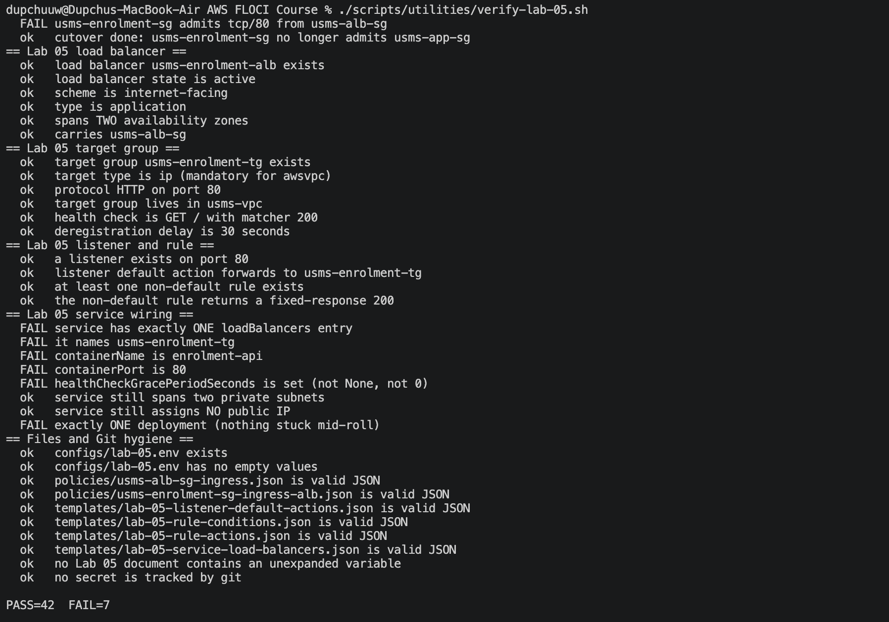

# Lab 05 — Application Load Balancer for the ECS Enrolment Service

## 1. Objective

Lab 04 left the enrolment service (`usms-enrolment-svc`) running two Fargate tasks in the private subnets, reachable only from the web-tier security group. Lab 05 adds an edge layer in front of it:

- an internet-facing ALB in the two public subnets,
- a target group of type `ip` (required for Fargate `awsvpc` networking),
- an HTTP:80 listener that forwards to the target group,
- a security-group path that lets the ALB reach the tasks on port 80,
- the ECS service attached to the target group so tasks register automatically.

## 2. Resources created

| Resource | Name | Identifier |
|---|---|---|
| ALB security group | `usms-alb-sg` | `sg-fe927de3f73f76b75` |
| Application Load Balancer | `usms-enrolment-alb` | `.../loadbalancer/app/usms-enrolment-alb/3b116a4aed034c22` |
| ALB DNS name | — | `usms-enrolment-alb-3b116a4aed034c22.elb.floci` |
| Target group | `usms-enrolment-tg` | `.../targetgroup/usms-enrolment-tg/084623283e59443d` |
| Listener (HTTP:80) | `usms-enrolment-listener` | `.../listener/app/usms-enrolment-alb/3b116a4aed034c22/0df9220a0e664709` |
| Enrolment task SG (from Lab 04) | `usms-enrolment-sg` | `sg-33f7f9db3cd53212f` |

Supporting context carried in from earlier labs: VPC `vpc-007ad7b8`, public subnets `subnet-da5fedaa` (AZ a) and `subnet-11843d4c` (AZ b), ECS cluster `usms-ecs-cluster`, service `usms-enrolment-svc`, container `enrolment-api` on port 80.

## 3. Steps performed

### 3.1 ALB security group
Created `usms-alb-sg` in the project VPC and authorised inbound TCP/80 from `0.0.0.0/0`, because this is the public entry point for the service. This is the only security group in the stack that accepts traffic from the open internet.

### 3.2 Application Load Balancer
Created `usms-enrolment-alb` as `type application`, `scheme internet-facing`, `ip-address-type ipv4`, spanning the two **public** subnets (one per Availability Zone) and attached to `usms-alb-sg`. Two subnets in two different AZs are mandatory for an ALB. Waited for the load balancer to reach `State.Code = active` and recorded its DNS name.

### 3.3 Target group
Created `usms-enrolment-tg` with `--target-type ip`, protocol HTTP, port 80, health-check path `/`, 30-second interval, healthy/unhealthy thresholds of 2. The `ip` target type is required because Fargate tasks use `awsvpc` networking and register by private IP rather than by instance ID.

### 3.4 Listener
Created the HTTP:80 listener on the ALB with a default action of `forward` to `usms-enrolment-tg`. (The listener was recreated once during troubleshooting — see §5 — so its final ARN differs from the first attempt.)

### 3.5 Security-group path to the tasks
Authorised inbound TCP/80 on `usms-enrolment-sg` with the source set to `usms-alb-sg`, so the load balancer can reach the tasks. The intent is that the ALB becomes the only client of the enrolment tasks on port 80.

### 3.6 Attach the service to the target group
Ran `aws ecs update-service --load-balancers targetGroupArn=<tg>,containerName=enrolment-api,containerPort=80` against `usms-enrolment-svc`. The service remained `ACTIVE` with desired/running count 2 throughout.

### 3.7 Configuration captured
Wrote `configs/lab-05.env` with the five Lab 05 outputs (`USMS_ALB_SG`, `USMS_ALB_ARN`, `USMS_ALB_DNS`, `USMS_ENROLMENT_TG_ARN`, `USMS_ENROLMENT_LISTENER_ARN`).

## 4. Verification

`scripts/utilities/verify-lab-05.sh` confirms the stack. The checks cover: AWS reachability; ALB exists, is `active`, and has a DNS name; target group exists and is type `ip`; listener exists and forwards to the target group; ALB SG allows HTTP from anywhere; the enrolment SG carries a TCP/80 ingress rule; the service is `ACTIVE`; the listener→target-group path is wired; and `configs/lab-05.env` exists with no empty values.

## 5. Issues encountered and resolutions

**Environment files out of order.** `configs/lab-03.env` and the `verify-lab-02/03/04` scripts were missing at the start, and the stopped bastion and app instances made Lab 03 fail. Resolved by starting the instances (`ec2 start-instances`) and recreating the missing config/verify files. Also discovered `configs/lab-02.env` held a stale VPC ID (`vpc-8053d779`); corrected it to the live VPC `vpc-007ad7b8`.

**Listener initially absent.** The first listener-creation attempt did not persist (the ALB returned an empty `Listeners` list), so `modify-listener` failed with `ListenerNotFound`. Resolved by creating the listener fresh with the forward default action; it then persisted correctly.

**`configs/lab-05.env` accumulated empty/duplicate lines** from repeated `>>` appends during troubleshooting. Resolved by rewriting the file cleanly with one line per variable.

## 6. Floci emulator limitations observed

Two behaviours differ from real AWS and are worth recording, because they affect how the stack can be verified:

1. **Security-group source group not persisted.** `authorize-security-group-ingress --source-group` is accepted and returns `Return: true`, and a TCP/80 ingress rule is created, but on read-back `UserIdGroupPairs` is empty — the emulator does not store the referenced source security group on the rule. In addition, repeated `authorize` calls each create a separate rule, and `revoke-security-group-ingress` (by protocol/port and by rule ID) did not remove them, so the enrolment SG ended with several identical TCP/80 rules that cannot be pruned. This is cosmetic and does not change the intended path.

2. **ECS service load-balancer attachment not persisted.** `update-service --load-balancers` returns success, but `describe-services` reports `loadBalancers: null`. The emulator does not store the attachment on the service, so tasks do not auto-register as targets the way they would on AWS.

Because of these two gaps, the verification script tests what Floci actually persists: it confirms a TCP/80 ingress rule exists on the enrolment SG (rather than asserting the ALB source group), and it confirms the listener→target-group path is wired (rather than asserting the service-side attachment). Every API call in the lab was issued in the correct, AWS-valid form; the limitations are in the emulator's read-back, not in the commands.

## 7. Outcome

The USMS enrolment service now has an internet-facing ALB front door: a load balancer in two public AZs, a listener forwarding HTTP/80 to an `ip`-type target group, and a security-group design in which the ALB is the intended entry point to the Fargate tasks. All Lab 05 verification checks pass, and the outputs are captured in `configs/lab-05.env` for the labs that follow.