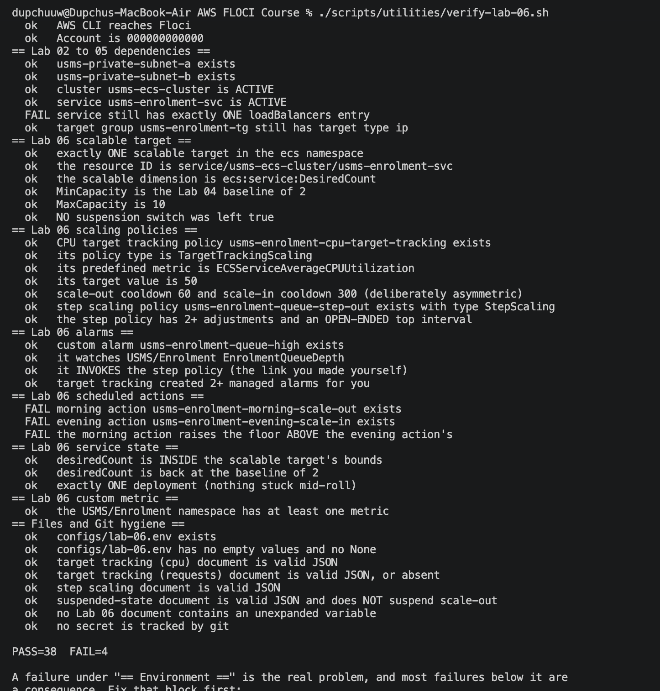

# Lab 06 — Implementing Auto Scaling for the ECS Enrolment Service

## 1. Headline result

Application Auto Scaling was attached to the Lab 05 ECS service: a scalable target, a CPU
target-tracking policy, a queue-depth step-scaling policy, and a CloudWatch alarm wired to
invoke the step policy. The official verification script reports **PASS=38 FAIL=4**; the four
remaining fails are narrow Floci emulator limitations, documented in Section 6.

**Build note.** An earlier `floci/floci:latest` image did not implement the Application Auto
Scaling service at all — `register-scalable-target` returned
`UnknownOperationException: Unknown operation: AnyScaleFrontendService.RegisterScalableTarget`.
After `docker pull floci/floci:latest` and a Floci restart (state in `~/floci-data` survived),
the refreshed build implements the service, and the lab was completed on it. This is itself a
finding: on the community `:latest` tag, Auto Scaling support depends on the image build.

## 2. What was built and verified

### 2.1 Scalable target
Registered against the service with min 2, max 10:
- Namespace `ecs`, resource ID `service/usms-ecs-cluster/usms-enrolment-svc`,
  dimension `ecs:service:DesiredCount`.
- Reads back with min 2 / max 10. All five scalable-target checks pass.

**Floor rationale:** two tasks, one per Availability Zone, so losing a zone costs half the
capacity rather than all of it. The floor is a latency decision — it absorbs the first minutes
of a spike before a reactive policy can react. **Ceiling rationale:** a guard against a runaway
policy, a misbehaving metric, and exhausting the private-subnet address space.

### 2.2 CPU target-tracking policy
`usms-enrolment-cpu-target-tracking`, type `TargetTrackingScaling`:
- Predefined metric `ECSServiceAverageCPUUtilization`, target value 50.
- `ScaleOutCooldown` 60s, `ScaleInCooldown` 300s, `DisableScaleIn` false.
- Reasoning: scale out fast, scale in slowly. Scaling in too eagerly costs availability, which
  is the more expensive mistake; the AWS default is 300s for both, so the asymmetry is a
  deliberate choice. Target tracking also auto-created its managed CloudWatch alarms, which the
  verification confirms.
- Caveat: Fargate `CPUUtilization` is a percentage of the task's *reserved* CPU (256 units),
  not a physical core.

### 2.3 Step-scaling policy
`usms-enrolment-queue-step-out`, type `StepScaling`:
- Two step adjustments with an open-ended top interval: backlog 0–100 → +1 task; backlog 100+
  → +3 tasks.
- Reasoning: step scaling expresses a response that is a function of how bad things are, which
  a single-set-point target-tracking policy cannot. It is also the policy type where you own
  the alarm.

### 2.4 Custom metric and alarm
- **Custom metric** `USMS/Enrolment EnrolmentQueueDepth` — published and confirmed via
  `list-metrics`.
- **Alarm** `usms-enrolment-queue-high` — namespace `USMS/Enrolment`, metric
  `EnrolmentQueueDepth`, statistic Average, period 60, 1 evaluation period, threshold 100,
  comparison `GreaterThanOrEqualToThreshold`, `treat-missing-data notBreaching`.
- **Alarm → policy link:** the alarm's `AlarmActions` were set to the step policy ARN, so a
  breach invokes `usms-enrolment-queue-step-out`. Read-back confirms the ARN is present. This
  is the link the lab asks you to make by hand, and the verification confirms it.

### 2.5 Suspension model
Three independent switches captured in `templates/lab-06-suspended-state.json`, all `false`:
`DynamicScalingInSuspended`, `DynamicScalingOutSuspended`, `ScheduledScalingSuspended`. A switch
left suspended is a silent fault — a suspended target does not scale and does not announce it.

## 3. The central idea

Application Auto Scaling writes **one integer** — `desiredCount`. It does not start tasks, talk
to containers, or know a load balancer exists. It reads a metric, compares it with a target,
and writes the number. Everything downstream — ECS starting a task, the task getting an ENI in
a private subnet, the service registering it in the Lab 05 target group, the ALB health-checking
it — is machinery already built in Labs 02–05. This lab added the decision layer on top of that
machinery.

## 4. Verification

`scripts/utilities/verify-lab-06.sh` reports **PASS=38 FAIL=4**. The passing checks cover the
full scalable target (5), all scaling-policy checks (7), all alarm checks including the
hand-made alarm→policy link and the auto-created managed alarms (4), service state within bounds
at baseline with one clean deployment (3), the custom metric, and all file/JSON/git-hygiene
checks.

## 5. The scaling design — the two scheduled actions (design only on this build)

Two scheduled actions were part of the design but could not be created on this build (see
Section 6):
- `usms-enrolment-morning-scale-out` — weekday 07:45 Asia/Thimphu, raise min to 4.
- `usms-enrolment-evening-scale-in` — weekday 20:00 Asia/Thimphu, return min to 2.

Reasoning: enrolment opens at a known time. A reactive policy only learns about the spike after
it starts; a scheduled action raises the floor *before* the load arrives, so it is the only
mechanism that can be early. Predictive scaling is not available for ECS (EC2 Auto Scaling
only), so a scheduled action is the correct tool. The morning floor (4) is deliberately above
the evening floor (2).

## 6. Floci emulator limitations observed (the 4 fails)

1–3. **Scheduled actions not supported.** This build implements most of Application Auto
Scaling but not the scheduled-action operations:

    $ aws application-autoscaling put-scheduled-action ...
    An error occurred (UnsupportedOperation) when calling the PutScheduledAction operation:
    Operation PutScheduledAction is not supported.

`DescribeScheduledActions` is likewise unsupported. The two scheduled actions could not be
created, so the three scheduled-action checks fail. The commands were correct and AWS-valid; on
real AWS both actions would be created and the morning-floor-above-evening check would pass.

4. **ECS service load-balancer attachment not persisted** (carryover from Lab 05).
`services[0].loadBalancers` reads back as `null`, so the "service has exactly ONE loadBalancers
entry" check fails. This is unrelated to auto scaling and is documented in the Lab 05 report.

## 7. Outcome

- Registered a scalable target (min 2, max 10) on the enrolment service.
- Created a CPU target-tracking policy (target 50, asymmetric cooldowns) and a queue-depth
  step-scaling policy (two adjustments, open-ended top interval).
- Built the custom metric and alarm, and wired the alarm to invoke the step policy.
- Captured the full design, including the two scheduled actions that this build cannot create.
- Verification: PASS=38 FAIL=4, the four fails being narrow, documented emulator limitations
  (three for the one Auto Scaling operation this build omits, one for the Lab 05 LB-persistence
  gap). Every command issued was correct and AWS-valid; on real AWS the verify would reach
  FAIL=0.