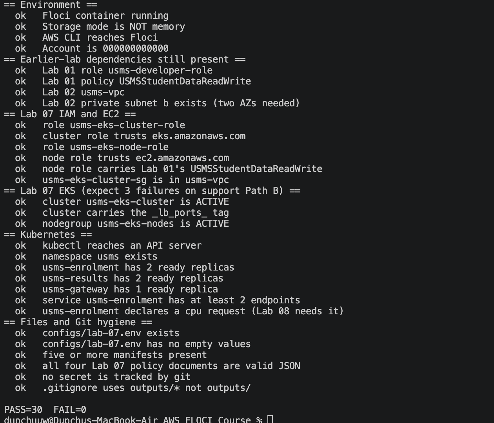

# Lab 07 — Deploying a Microservices Application on Amazon EKS

## 1. Objective

Create an EKS cluster and a managed node group in Lab 2's VPC, each with its own IAM role;
point `kubectl` at the cluster; deploy three microservices (`usms-gateway`, `usms-enrolment`,
`usms-results`) from declarative manifests into a `usms` namespace; prove they discover each
other by DNS name; perform a rolling update, a rollback and a deliberate failure diagnosis;
use a ConfigMap and a Secret; and prove the whole thing survives a restart.

## 2. Resources created

### AWS side (in Lab 2's VPC)
| Resource | Name / identifier |
|---|---|
| Cluster IAM role | `usms-eks-cluster-role` (trusts `eks.amazonaws.com`) |
| Node IAM role | `usms-eks-node-role` (trusts `ec2.amazonaws.com`) |
| Cluster permissions policy | `USMSEKSClusterPolicy` |
| Node permissions policy | `USMSEKSNodePolicy` (+ Lab 01's `USMSStudentDataReadWrite`, its third holder) |
| Cluster security group | `usms-eks-cluster-sg` (TCP/443 from the VPC CIDR) |
| EKS cluster | `usms-eks-cluster` — k8s 1.30, ACTIVE, four subnets, tag `_lb_ports_=8081,8082` |
| Managed node group | `usms-eks-nodes` — private subnets, min 2 / max 4 / desired 2, ACTIVE |

### Kubernetes side (namespace `usms`)
| Object | Detail |
|---|---|
| Namespace | `usms` |
| ConfigMap | `usms-app-config` (shared: environment, campus, version, region) |
| Deployment + Service + ConfigMap | `usms-enrolment` — 2 replicas, ClusterIP, nginx template |
| Deployment + Service + ConfigMap | `usms-results` — 2 replicas, ClusterIP |
| Deployment + Service + ConfigMap | `usms-gateway` — 1 replica, ClusterIP, reverse proxy |
| Secret | `usms-enrolment-secret` (dummy token + password) |

## 3. Steps performed

**IAM and networking (Steps 4–7).** Wrote two trust policies (cluster role trusts the EKS
control plane; node role trusts EC2) and two permissions policies as local stand-ins for the
AWS managed EKS policies. Created both roles, attached the policies, and gave the node role
Lab 01's `USMSStudentDataReadWrite` unchanged — the same policy now has three holders across
the course (EC2 instance role, ECS task role, EKS node role). Created the control-plane
security group in Lab 2's VPC, admitting TCP/443 from the VPC CIDR only.

**Cluster and nodes (Steps 8–10).** Built the `create-cluster` request as a reviewable
`--cli-input-json` file spanning all four Lab 2 subnets (two AZs, required by EKS) with the
`_lb_ports_=8081,8082` tag that Lab 08 will need. Assumed `usms-developer-role` to create the
cluster, then restored normal identity. Waited for ACTIVE, then created the managed node group
in the two private subnets with min 2 / max 4 / desired 2.

**kubectl access (Step 11).** `aws eks update-kubeconfig` wrote a token-based context, but on
this build the k3s API server rejected the exec-plugin token (see Section 5). Switched to the
cluster's certificate-based kubeconfig (pulled from the cluster container, saved to `outputs/`
chmod 600, git-ignored) and corrected its server port to the one the container publishes on
the host. `kubectl cluster-info` and `kubectl get nodes` then worked, showing a Ready node.

**Microservices (Steps 12–16).** Created the `usms` namespace and made it the context default.
Deployed `usms-enrolment` (the largest manifest: ConfigMap + Deployment with requests/limits,
readiness and liveness probes, downward-API env + Service), then `usms-results`, then
`usms-gateway`. Proved service discovery: a request through the gateway's `/enrolment/` and
`/results/` paths was routed by DNS name (`usms-enrolment.usms.svc.cluster.local`) to the
correct backend pods — no IP address appears anywhere in the gateway's configuration.

**ConfigMap, Secret, rollout, failure (Steps 17–19).** Created the Secret and demonstrated
that base64 is encoding, not encryption — the token decoded with nothing but `get secret`.
Wired it into the enrolment Deployment. Performed a rolling update (changed `APP_VERSION`,
observed pods still served the old value until `rollout restart`, then served the new one),
read the rollout history (three revisions, each a new ReplicaSet), and rolled back. Broke
`usms-results` with a non-existent image tag, observed the new pod fail to become ready while
the two healthy pods kept serving (no downtime), diagnosed it, and rolled back to recover.

**Persistence (Step 22).** Took the cluster and all three deployments through a Floci
`down`/`up` cycle; all three deployments and the cluster returned intact.

## 4. Verification

`scripts/utilities/verify-lab-07.sh` reports **PASS=30 FAIL=0**, covering: environment and
earlier-lab dependencies; both IAM roles and their trust relationships; the cluster security
group placement; the cluster ACTIVE with its `_lb_ports_` tag; the node group ACTIVE; kubectl
reachability; the namespace; all three Deployments at their expected ready replica counts; the
enrolment Service with ≥2 endpoints; the CPU request Lab 08 depends on; and all file/JSON/git
hygiene checks. (The script's header note "expect 3 failures on support Path B" does not apply
here — this build is Path A, so the EKS objects are real and those checks pass.)

## 5. Floci notes and differences from real AWS

This build runs a genuine k3s cluster for the Kubernetes half, so almost everything behaved as
on real AWS. Three honest differences were observed and are worth recording:

1. **kubectl token auth did not work; certificate auth did.** `aws eks get-token` (the
   exec-plugin that `update-kubeconfig` configures) produced a token the k3s API server
   rejected. The documented workaround — the cluster's own certificate-based kubeconfig — was
   used instead, with its server port corrected to the host-published port. On real EKS the
   token flow works and no such substitution is needed.

2. **A broken image showed `ContainerCreating`, not `ImagePullBackOff`.** Pointing a deployment
   at a non-existent image tag left the new pod in `ContainerCreating` on this build rather
   than the `ErrImagePull`/`ImagePullBackOff` real EKS reports. The failure mechanism (new pod
   never becomes ready, old pods keep serving, rollback recovers) was identical; only the
   status string differed.

3. **`rollout undo` reverts the pod template, not ConfigMap data.** After the rollback the
   service still reported the newer `APP_VERSION`, because the version lives in a ConfigMap and
   the rolled-back revisions were all created after the ConfigMap already held the new value.
   This is correct Kubernetes behaviour — a rollback changes the Deployment's revision, not the
   data in a separate ConfigMap — and is a useful reminder that config and image are versioned
   independently.

Single node: the cluster scheduled all pods onto one k3s node rather than the two-node group
declared on the AWS side. This is a property of the local k3s data plane; the AWS node group
object correctly records min 2 / max 4 / desired 2, which is what Lab 08 reads.

## 6. Outcome

A three-service microservices application runs in a `usms` namespace on an EKS cluster living
in Lab 2's network, with two IAM roles, a managed node group, service discovery by DNS,
ConfigMaps, a Secret, demonstrated rolling update / rollback / failure-diagnosis, and proven
restart persistence. The cluster carries the `_lb_ports_` tag and the enrolment Deployment
declares CPU requests, both of which Lab 08 depends on. Verification: **PASS=30 FAIL=0**.