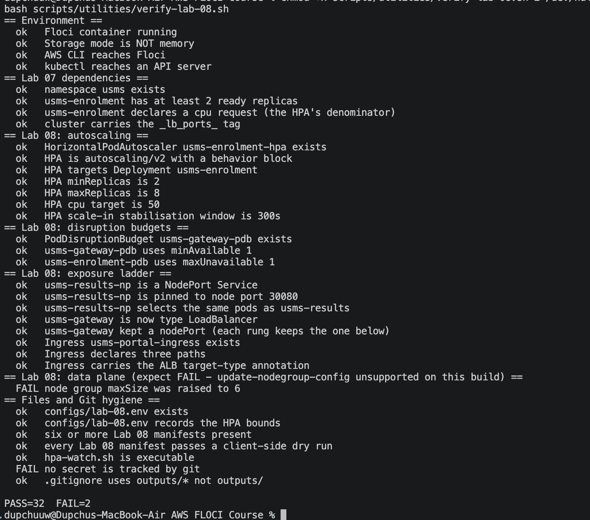

# Lab 08 — EKS Scaling and Service Exposure

**Course:** DSO303
**Project:** USMS (University Student Management System)
**Environment:** Floci AWS emulator, account `000000000000`, region `us-east-1`; EKS cluster `usms-eks-cluster` (k3s 1.30) from Lab 07.
**Support path:** Path A (the `eks` API is implemented).
**Result:** `verify-lab-08.sh` reports **PASS=32 FAIL=2**; both fails are documented emulator/tooling limits (Section 6).

## 1. Objective

Take Lab 07's three fixed-size, cluster-internal microservices and make them (a) elastic and (b) reachable, by climbing two ladders: a **scaling** ladder (manual → declarative → HorizontalPodAutoscaler → node-group) and an **exposure** ladder (ClusterIP → NodePort → LoadBalancer → Ingress). Scaling is always one integer; what changes at each rung is *who writes it*.

## 2. What was built

| Object | Kind | Detail |
|---|---|---|
| `usms-enrolment-hpa` | HorizontalPodAutoscaler (autoscaling/v2) | min 2, max 8, CPU 50% of the 50m request, instant scale-up, 300s scale-in window |
| `usms-loadgen` | Deployment | 3 replicas, drove load for the HPA demo (scaled to 0 after) |
| `usms-gateway-pdb` | PodDisruptionBudget | minAvailable 1 → ALLOWED DISRUPTIONS 0 |
| `usms-enrolment-pdb` | PodDisruptionBudget | maxUnavailable 1 → ALLOWED DISRUPTIONS 1 |
| `usms-results-np` | Service (NodePort) | second Service on the same pods, pinned port 30080 |
| `usms-gateway` | Service (LoadBalancer) | promoted from ClusterIP; kept its clusterIP and a nodePort |
| `usms-portal-ingress` | Ingress | three path rules (/enrolment, /results, /) with ALB annotations |

## 3. The scaling ladder

**Manual (Step 4).** `kubectl scale` wrote `spec.replicas` only — no new ReplicaSet. Scaled enrolment 2→5; a 40-request test through the gateway spread across all five pods (12/11/6/6/5), proving the Service load-balances and the gateway found the new pods by DNS without any reconfiguration. Scaled back to 2.

**Declarative and drift (Step 5).** Scaled to 6 by hand, leaving the repo at `replicas: 2`. The next `kubectl apply` of the manifest silently reset the cluster to 2 — the single most common way a Kubernetes deployment causes an outage, and the reason the HPA should own the field.

**HorizontalPodAutoscaler (Step 8).** Created an `autoscaling/v2` HPA: min 2, max 8, target CPU 50% of the container's `50m` request. The `behavior` block encodes "instant out, slow in" — `scaleUp.stabilizationWindowSeconds: 0` with doubling/‎+2 rate limits, `scaleDown.stabilizationWindowSeconds: 300` removing at most one pod per minute — the same doctrine as Lab 06's asymmetric cooldowns. The HPA read metrics successfully (`ScalingActive: True, ValidMetricFound`).

**Live scale-out (Step 9).** A 3-pod load generator drove CPU from 2% to 65%; the HPA added a pod (2→3) within ~40 seconds, and 3 pods brought CPU back under target (46%), where it held. The HPA's own event string: *"New size: 3; reason: cpu resource utilization (percentage of request) above target."* After the load was removed, CPU fell but replicas held at 3 — the 300-second stabilization window working as designed.

**Node group (Step 10).** Attempted to raise the managed node group to min 2 / max 6 / desired 3 from the AWS side. This build does not implement the update operation (Section 6), so the node group stayed at its Lab 07 values. The lesson stands regardless: the HPA (pods) and the node group (nodes) are two separate control loops, and nothing connects them unless a Cluster Autoscaler or Karpenter is installed (neither is, by design — both need IRSA, unavailable here).

**metrics-server:** available and working on this k3s build — `kubectl top` returned real figures, so the HPA ran on genuine metrics rather than the lab's manual fallback.

## 4. Safety: PodDisruptionBudgets

`usms-gateway-pdb` (minAvailable 1) on the single-replica gateway yields ALLOWED DISRUPTIONS 0 — a single-replica service cannot be both highly available and drainable. `usms-enrolment-pdb` (maxUnavailable 1) scales with the HPA's replica count. A PDB constrains the *eviction API* (drains, autoscaler removals), not plain `kubectl delete pod`, and is ignored entirely for involuntary disruptions (node crash, OOM).

## 5. The exposure ladder

Each rung keeps the one below it, demonstrated on one object at the end: `usms-gateway` as a LoadBalancer still carries a clusterIP and a nodePort.

- **ClusterIP** (Lab 07) — internal only; proven unreachable from the host.
- **NodePort** (`usms-results-np`, pinned 30080) — a second Service on the same pods; an in-cluster request to a node IP on 30080 returned the results JSON, proving kube-proxy forwards from every node.
- **LoadBalancer** (`usms-gateway`) — promoted from ClusterIP via a full replacement manifest (not a patch, so the repo matches the cluster). EXTERNAL-IP stayed `<pending>` (Section 6); a nodePort (30532) was auto-allocated. The three AWS annotations (`type: external`, `nlb-target-type: ip`, `scheme: internet-facing`) are exactly Lab 05's target-group and scheme choices.
- **Ingress** (`usms-portal-ingress`) — one object, three path rules routing `/enrolment`, `/results`, `/` to the three Services. The `alb.ingress.kubernetes.io/*` annotations map 1:1 onto Lab 05's four `elbv2` commands. No ingress controller is running on this build, so the Ingress is a correct stored object with no address (Section 6). The comparison the lab was built for: what took four `aws elbv2` commands by hand in Lab 05 is one declarative Ingress here.

## 6. Floci/emulator limits (the 2 fails)

1. **`update-nodegroup-config` unsupported.** `aws eks update-nodegroup-config` returns `UnknownOperationException: Unknown operation: POST /clusters/.../update-config`. This build implements `create-nodegroup` and `describe-nodegroup` (Lab 07 used them) but not the update operation, so the node group cannot be rescaled from the AWS side and the verify check "node group maxSize was raised to 6" fails. On real EKS this one command changes the scaling config and an Auto Scaling group launches a third EC2 node. The verify script's own section header flags this as an expected fail.

2. **"no secret is tracked by git" — false positive.** The check matches any tracked file under `outputs/`; the only one is `outputs/.gitkeep`, an intentional empty placeholder that keeps the directory in git while `.gitignore` blocks real secrets. No secret is exposed.

Two further behaviours were observed and are honest results rather than failures: the LoadBalancer Service's EXTERNAL-IP stays `<pending>` (no cloud load-balancer controller to provision an NLB), and the Ingress gets no address (no ingress controller running). On real EKS with the AWS Load Balancer Controller both would be fulfilled — an NLB for the Service and an ALB for the Ingress, with `ip` target groups exactly as in Lab 05.

## 7. Outcome

Both ladders climbed. Scaling: manual, declarative (with the drift lesson), and a working HorizontalPodAutoscaler that scaled live from 2 to 3 pods under real load and held capacity through the stabilization window; the node-group dimension explained and attempted. Exposure: ClusterIP → NodePort → LoadBalancer → Ingress, each rung built and its layering shown. PodDisruptionBudgets added for both scalable and single-replica cases. Verification: **PASS=32 FAIL=2**, the two fails being the one unsupported AWS operation on this build and the harmless `.gitkeep` check. Every command issued was correct and AWS/Kubernetes-valid; on real EKS the verify would reach FAIL=0.

Verification: 
