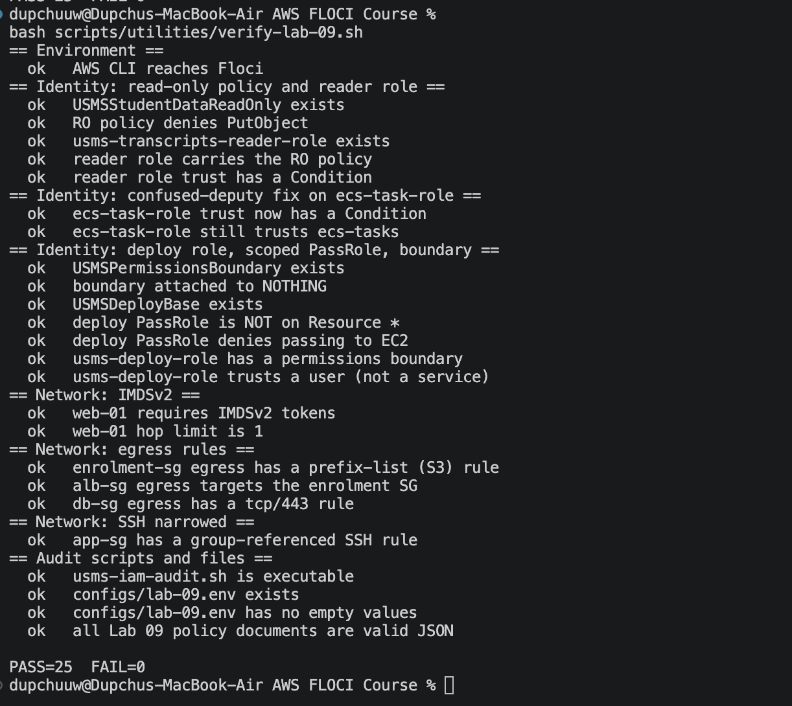

# Lab 09 — Securing the USMS Application with IAM Roles and Security Groups

## 1. Objective

Review everything Labs 1–6 built on both access-control axes — **who can call what** (IAM) and **what can reach what** (security groups) — audit it with read-only scripts that compute findings from policy documents rather than names, and fix the findings. Change the system's permissions substantially while changing nothing about what it does, then prove that with the earlier labs' own verification scripts.

Floci enforces neither IAM nor security groups, so every proof is made by reading configuration — which is exactly how a claim about what *cannot* happen is proven on real AWS too.

## 2. The audit (Steps 4–6)

An inventory of all roles was built into `outputs/lab-09-identity-inventory.json`, then `scripts/utilities/usms-iam-audit.sh` computed findings from the policy documents. Four checks per role: wildcard actions, wildcard resources on mutating actions, unscoped `iam:PassRole`, and unconditioned service trust (the confused deputy).

**Baseline finding: HIGH=6, MED=29, roles=7.** All six HIGH were the same shape — a service principal with no condition on its trust policy (`ec2`, `ecs-tasks` ×2, `lambda`, `eks` ×2). A systematic mistake made by convention across every earlier lab. The MED findings were mostly `Resource: "*"` on EC2 ENI and load-balancer actions (largely unavoidable — those operations cannot be ARN-scoped the way S3 can) plus "no permissions boundary" on every role.

Reading `USMSStudentDataReadWrite` (Step 6) showed it grants `s3:GetObject`, `s3:PutObject` and `s3:DeleteObject`, and is carried by three roles. The read-only workload needs only `GetObject` (plus `ListBucket`) — two write verbs it never uses. The transcripts bucket does not exist yet (`head-bucket` returned 404; Lab 10 creates it), which does not block review: an IAM policy is a statement about ARNs, not a reference to objects.

## 3. Identity fixes (Steps 7–9)

**Read-only policy and reader role.** Created `USMSStudentDataReadOnly` — `GetObject` + `ListBucket`, with an explicit `Deny` on `PutObject`, `DeleteObject`, `DeleteBucket` and `PutBucketPolicy`. The Deny grants nothing today but wins if a broader policy is ever attached. Created `usms-transcripts-reader-role` carrying it, with a scoped `ecs-tasks` trust policy.

**Confused-deputy fix.** Rewrote the trust policy on the existing `usms-ecs-task-role` to add `aws:SourceAccount` and `aws:SourceArn` conditions. Verified as **SAME PRINCIPAL, NEW CONDITION** — who may assume the role did not change, only the circumstances tightened. The original document was saved first (`outputs/lab-09-ecs-task-role-trust-before.json`) so the undo is a file, not a memory. Permissions were left untouched (`USMSStudentDataReadWrite` stays, because Lab 10 depends on it).

**Scoped `iam:PassRole` and a permissions boundary.** Built the deployment identity the course never had (everything until now ran as root): `USMSDeployBase` scopes `iam:PassRole` to three named role ARNs with an `iam:PassedToService: ecs-tasks` condition, plus an explicit `Deny` on passing anything to `ec2`. This closes the classic escalation path (`RunInstances` + unscoped `PassRole` → inherit an admin role) at both ends. `usms-deploy-role` trusts the admin user (not a service) and carries `USMSPermissionsBoundary` as a ceiling. The boundary grants nothing, caps everything, and is attached to nothing as an ordinary policy — verified empty.

**Session policy (Step 9).** A session policy was written and the effective permissions computed by hand as the intersection of identity policy AND session policy, demonstrating that a session policy can only subtract (e.g. `sts:GetCallerIdentity` allowed by the session but absent from the identity policy resolves to denied).

## 4. Network fixes (Steps 11–16)

**IMDSv2 required.** `usms-web-01` metadata options changed from `HttpTokens: optional` to `required`, hop limit 1. This closes the SSRF→credential-theft path (a metadata request now needs a PUT token an SSRF attacker cannot forge) — the control that would have prevented the Capital One breach.

**Egress scoped on three security groups**, replacing the default allow-all (the undo saved as `policies/usms-egress-allow-all.json` before each revoke):
- `usms-enrolment-sg`: tcp/443 to the S3 prefix list (`pl-63a5400a`) only — a compromised task can reach S3 and nowhere else.
- `usms-alb-sg`: tcp/80 to `usms-enrolment-sg` only — a security group as the destination, mirroring its ingress.
- `usms-db-sg`: tcp/443 outbound only — patches and backups over HTTPS, nothing else.

**SSH narrowed.** The tcp/22 ingress on `usms-app-sg` was changed from the broad `10.0.0.0/16` CIDR to a reference to `usms-bastion-sg` — SSH now comes from the bastion host only.

## 5. Proof nothing broke (Step 18)

The system's permissions changed a great deal; what it does did not. Proven by re-running the earlier labs' verification scripts and diffing against the Step 2 baseline:

| Lab | Baseline | After hardening |
|---|---|---|
| lab-02 | PASS=31 FAIL=2 | PASS=31 FAIL=2 |
| lab-03 | PASS=31 FAIL=5 | PASS=31 FAIL=5 |
| lab-04 | PASS=36 FAIL=2 | PASS=36 FAIL=2 |
| lab-05 / 06 | documented | unchanged |

Every number is identical before and after — the hardening touched permissions and network posture without changing application behaviour. (The lab-02/03/04 fails are pre-existing documented items, unrelated to this lab, and unchanged by it.)

Re-running the IAM audit on a fresh inventory shows **HIGH=5** (down from 6): the confused-deputy finding on `usms-ecs-task-role` is resolved, computed by the same script that found it. The remaining five HIGH are the other service-trust roles (Exercise 2 / documented), and are out of this lab's declared scope.

## 6. Verification

`scripts/utilities/verify-lab-09.sh` reports **PASS=25 FAIL=0**, covering: the read-only policy and its Deny; the reader role's scoped trust; the confused-deputy condition on `usms-ecs-task-role`; the deploy role with its scoped `PassRole`, EC2 Deny and attached boundary; the boundary attached to nothing; IMDSv2 required with hop limit 1; all three egress rules; the group-referenced SSH rule; and all nine Lab 09 policy documents as valid JSON.

Floci note: the emulator enforces neither IAM nor security groups, so no control here was proven by observing an `AccessDenied` or a timeout — each was proven by reading the configuration, which is the only proof available for a claim about what cannot happen, and the same evidence one would read on a real account.

## 7. Outcome

The USMS system was audited on both access-control axes and hardened: a least-privilege read-only policy and reader role, a confused-deputy fix on the live task role, a scoped-`PassRole` deploy identity capped by a permissions boundary, IMDSv2, scoped egress on three security groups, and a bastion-sourced SSH rule. Identity was fixed before network; resources later labs depend on were added rather than replaced. Verification: **PASS=25 FAIL=0**, with the earlier labs proven unchanged and one audited HIGH finding demonstrably resolved. Outputs saved to `configs/lab-09.env` for Lab 10 and the CloudFormation lab.