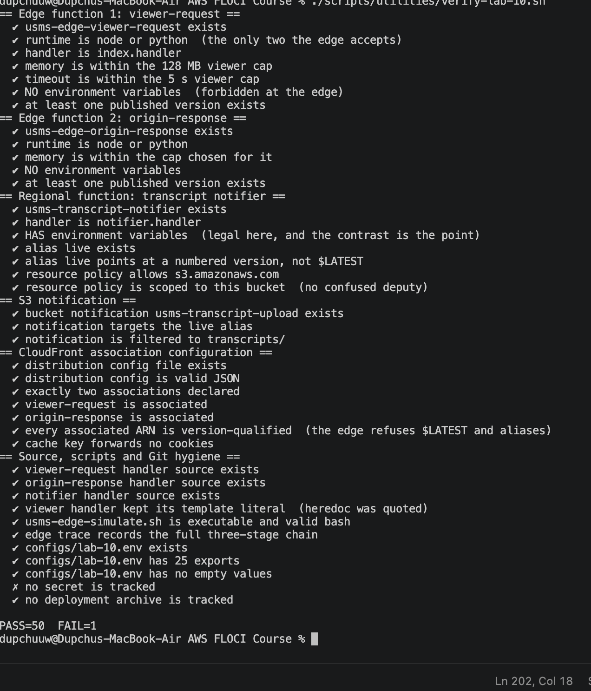

# Lab 10 — Edge Functions with AWS Lambda


## 1. Objective

Create `usms-student-data`, the bucket Lab 01's `USMSStudentDataReadWrite` has named since the first day, and use it as the origin for a transcript-delivery path. Build two Lambda@Edge functions (viewer-request and origin-response), test them with real CloudFront events, publish versions, check them against the edge restrictions, and associate them with a CloudFront distribution. Build a separate regional function triggered by S3 uploads, with an alias and a scoped resource policy, and prove it ran. Prove everything survives a restart.


## 2. Resources created

| Resource | Identifier |
|---|---|
| Origin bucket | `usms-student-data` (tags Project=USMS, Tier=data, Lab=06) |
| Execution role (updated) | `usms-lambda-exec-role` — trust now `lambda.amazonaws.com` + `edgelambda.amazonaws.com` |
| Edge function 1 | `usms-edge-viewer-request` — nodejs20.x, 128 MB, 5 s, version `1` |
| Edge function 2 | `usms-edge-origin-response` — nodejs20.x, 128 MB, 5 s, version `1` |
| Regional function | `usms-transcript-notifier` — python3.12, 256 MB, 30 s, versions `1` and `2` |
| Alias | `live` → version `1` on the notifier |
| CloudFront distribution | `E0Y0L58R29EYYF` (`e0y0l58r29eyyf.cloudfront.net`), Deployed |
| Resource policy statement | `usms-s3-transcript-upload` on `usms-transcript-notifier:live` |
| Bucket notification | `usms-transcript-upload` — `s3:ObjectCreated:*`, prefix `transcripts/`, suffix `.json` |
| Simulator | `scripts/utilities/usms-edge-simulate.sh` |
| Configuration | `configs/lab-10.env` (25 exports) |


## 3. The edge path

### 3.1 Origin bucket (Step 5)
Created `usms-student-data`. `head-bucket` exited 0 for the first time in the course. The ARNs in `USMSStudentDataReadWrite` (`arn:aws:s3:::usms-student-data` and `/*`) now resolve to a real bucket, so every role carrying that policy — and Lab 09's `usms-transcripts-reader-role` — points at an existing resource. IAM policies name resources by ARN and do not require them to exist; the policy was never wrong, it was waiting.

### 3.2 Execution role (Step 6)
The trust policy was replaced with one naming both `lambda.amazonaws.com` and `edgelambda.amazonaws.com`. CloudFront replicates Lambda@Edge functions using the second principal; omitting it is the most common Lambda@Edge setup error. `update-assume-role-policy` replaces the whole document, so both principals had to be listed. Read-back count: 2.

### 3.3 Viewer-request function (Steps 7–9)
Runs on every request before the cache. It lowercases the URI (one cache entry per object) and, for `/transcripts/`, returns a `403` response itself when the `x-usms-student` header is missing, so the origin is never contacted. On the allow path it stamps `x-usms-edge: viewer-request-allow;student=<id>`.

- **Allow event:** `/transcripts/2026/STU-00417.json` → `/transcripts/2026/stu-00417.json`, header `viewer-request-allow;student=stu-00417`.
- **Deny event:** returned a *response* object — `status 403`, `x-usms-edge: viewer-request-deny`, a JSON body, and no `uri` key. `FunctionError` was `None`: the function did not fail, it decided.

The handler file was written with a quoted heredoc so the template literal `${studentId.toLowerCase()}` survived intact (verified by `grep`).

### 3.4 Logs and version (Steps 10–11)
The log group `/aws/lambda/usms-edge-viewer-request` exists and holds data. Version `1` was published with timeout 5 s and memory 128 MB. CloudFront accepts only an immutable, version-qualified ARN (`...:function:usms-edge-viewer-request:1`); it refuses `$LATEST` and aliases because both can move while replication is in progress.

### 3.5 Origin-response function (Steps 12–13)
Runs after the origin replies and before the object is cached, so headers added here are stored once and served from cache. It overwrites four security headers (`Strict-Transport-Security`, `X-Content-Type-Options`, `X-Frame-Options`, `Referrer-Policy`), sets `Cache-Control: public, max-age=300, s-maxage=3600` on transcripts, and records `x-usms-edge-chain`. Invoked result: `viewer-request-allow;student=stu-00417;origin-response` — the first evidence that the two functions compose. Version `1` published.

### 3.6 Edge restrictions (Step 14)
Environment variables were added to the viewer function deliberately. Floci accepted the call, as real AWS also would — the rejection on AWS happens later, at CloudFront association time. The variables were removed and both functions checked statically: **6/6 checks pass for each** (no environment variables, memory ≤ 128 MB, timeout ≤ 5 s, Node.js runtime, no VPC configuration, a published version). Because the emulator does not enforce these rules, they have to be checked by reading the configuration.

### 3.7 CloudFront distribution (Step 15, Path A)
Created distribution `E0Y0L58R29EYYF` from a reviewable config: origin `usms-student-data.s3.us-east-1.amazonaws.com`, `redirect-to-https`, cache key = URI + one header (`x-usms-student`), no cookies, no query string. Associations read back from the API:

| Event type | Function ARN |
|---|---|
| viewer-request | `...:function:usms-edge-viewer-request:1` |
| origin-response | `...:function:usms-edge-origin-response:1` |

### 3.8 End-to-end simulation (Step 16)
No local emulator executes Lambda@Edge, so `usms-edge-simulate.sh` chains the two real functions the way CloudFront would:

- **Allow run:** viewer-request → simulated origin → origin-response. Final response `200` with the four security headers, `cache-control`, and `x-usms-edge-chain: viewer-request-allow;student=stu-00417;origin-response`. That value exists only if the second function read what the first wrote.
- **Deny run:** chain of one stage, `403`, origin never contacted — an unauthenticated request costs one edge invocation and no origin traffic.


## 4. The regional path

### 4.1 Notifier, versions and alias (Steps 17–18)
`usms-transcript-notifier` (Python 3.12) reacts after a transcript lands; nobody waits on it, so it is regional, not an edge function. Unlike the edge functions it carries environment variables (`USMS_BUCKET`, `USMS_NOTIFY_CHANNEL`) — legal here, forbidden at the edge.

Version `1` was published and alias `live` created. Roll-forward/rollback test: version `2` published, `live → 2`, then `live → 1`. All of `$LATEST`, `1` and `2` remained — repointing an alias never deletes a version, which is why a rollback is one instant call with no trigger change.

### 4.2 Resource policy (Step 19)
The execution role says what the code may do; a resource-based policy on the function says who may call it. Statement `usms-s3-transcript-upload` allows `s3.amazonaws.com` to invoke `usms-transcript-notifier:live`, conditioned on `arn:aws:s3:::usms-student-data` — the same confused-deputy protection Lab 09 added to trust policies.

### 4.3 Notification and proof it ran (Steps 20–21)
The bucket notification targets the `:live` alias for `s3:ObjectCreated:*`, filtered to `transcripts/` + `.json`. Three uploads produced three log lines:

```
USMS_NOTIFY {"bucket": "usms-student-data", "event": "ObjectCreated:Put", "key": "transcripts/evidence/lab-10-edge-trace.json", "readable": true, "size": 623}
USMS_NOTIFY {... "key": "transcripts/evidence/second-upload.json", "readable": true ...}
USMS_NOTIFY {... "key": "transcripts/evidence/third-upload.json", "readable": true ...}
```

This proves the full chain: upload → bucket notification → function. `readable: true` shows the function's `head_object` call reached S3 and found each object, exercising its `s3:GetObject` permission.

**Filter test:** `notes/ignore-me.json` (wrong prefix) and `transcripts/evidence/ignore-me.txt` (wrong suffix) were uploaded. The bucket grew to 5 objects but the `USMS_NOTIFY` count stayed at 3 — neither triggered the function.

### 4.4 Persistence (Step 22)
A snapshot of functions, alias, distribution, object count and notification was taken before and after a Floci `down`/`up`. Result: **IDENTICAL**.


## 5. Issues encountered and how they were diagnosed

**1. Every Lambda invoke timed out, even at 30 seconds.** The handler is trivial, so this was not cold start. Floci's log showed the cause:

```
DockerHostResolver  Running in Docker — using current network IP for Runtime API: 10.0.0.2
LAMBDA_RUNTIME Failed to get next invocation. No Response from endpoint
```

When Lab 02's VPC was created, Floci attached itself to a Docker network for `usms-vpc` (`10.0.0.2`) as well as the Compose network (`floci-course_default`, `172.22.0.2`). It handed function containers the VPC-network address, which they cannot reach, so they never received the event. Fix: added one line to `docker-compose.yml` and restarted:

```yaml
FLOCI_SERVICES_LAMBDA_DOCKER_NETWORK: floci-course_default
```

After the restart Floci advertised `172.22.0.2` and the first invoke succeeded. The fix is in the compose file, so it persists across restarts (confirmed by the Step 22 restart).

**2. The first S3 event stalled.** Floci logged `Launching container` for the notifier and then nothing. It was silently pulling the 779 MB `public.ecr.aws/lambda/python:3.12` runtime image. Running `docker pull` on the host made progress visible; once the image arrived, the queued events were delivered and none were lost.

**3. Packaging failed with "No such file or directory".** `configs/course.env` sets `COURSE_ROOT` to an older project folder (`~/aws-floci-course`), so zip archives were written to a path that no longer exists. Fixed by `export COURSE_ROOT="$PWD"` after sourcing `course.env`. Worth correcting in `course.env` itself.

**4. Four verify checks failed on the execution role.** `configs/lab-01.env` stores `USMS_ROLE_LAMBDA` as the role's full ARN; `aws iam get-role --role-name` needs the plain name, so the checks queried a role named `arn:aws:iam::...`. The lab's Step 2 expects the variable to be the name (`usms-lambda-exec-role`). `configs/lab-10.env` (sourced after `lab-01.env`) now exports `USMS_ROLE_LAMBDA=usms-lambda-exec-role`, keeping the file at 25 exports. The role itself was always correct.


## 6. Floci vs real AWS

| Behaviour | Real AWS | This Floci build |
|---|---|---|
| Lambda@Edge execution | Replicated to edge locations, runs on the request path | Not executed; functions invoked directly and chained by `usms-edge-simulate.sh` |
| CloudFront distribution | Validates every association, deploys over minutes | Stored record, `Deployed` immediately; no edge, cache or request path |
| Edge restrictions (env vars, caps, version-qualified ARN) | Enforced at association time (`InvalidLambdaFunctionAssociation`) | Not enforced; checked statically instead |
| Trust and resource policies | Evaluated on every assume / invoke | Stored, not evaluated |
| `add-permission --source-account` | Stored as `AWS:SourceAccount` condition | Dropped — only `AWS:SourceArn` was persisted |
| `--log-type Tail` `LogResult` | Base64 of the last 4 KB of log | Not standard base64; decoded to noise. Log group used instead |
| Timeout clock | Starts when the handler is invoked | Includes container start-up |
| S3 → Lambda delivery | Within seconds | Worked, after the runtime image was pulled |


## 7. Verification

`scripts/utilities/verify-lab-10.sh` (the official Section 8.1 script) reports **PASS=50 FAIL=1** across: environment, origin bucket, execution role (both principals and `USMSLambdaBasic`), both edge functions against the edge restrictions, the notifier's handler, environment variables, alias and scoped resource policy, the S3 notification and its filter, the CloudFront association configuration (two associations, version-qualified ARNs, no cookies in the cache key), the source files, the simulator, the three-stage trace, the 25-export env file, and that no deployment archive is tracked.

**The one fail — "no secret is tracked" — is a false positive.** The check flags any tracked file under `outputs/`. The only one is `outputs/.gitkeep`, an intentional empty placeholder that keeps the directory in git while `.gitignore` (`outputs/*`) blocks every real output, including this lab's three `.zip` archives (confirmed by the passing "no deployment archive is tracked" check). No secret is exposed. The same false positive appears in Labs 04, 05 and 08.



## 8. Outcome

`usms-student-data` exists and is the origin for a transcript path in which a viewer-request function authenticates and normalises requests before the cache, and an origin-response function adds security headers before caching. Both functions satisfy the Lambda@Edge restrictions, are published as immutable versions, and are associated with distribution `E0Y0L58R29EYYF`; their composition is proven by the simulator's chain header. A regional notifier, reached through a movable `live` alias and a bucket-scoped resource policy, ran on real S3 uploads and ignored uploads outside its filter. Everything survived a restart. Verification: **PASS=50 FAIL=1**, the single fail being the `.gitkeep` placeholder. Identifiers are saved in `configs/lab-10.env` for the labs that follow.