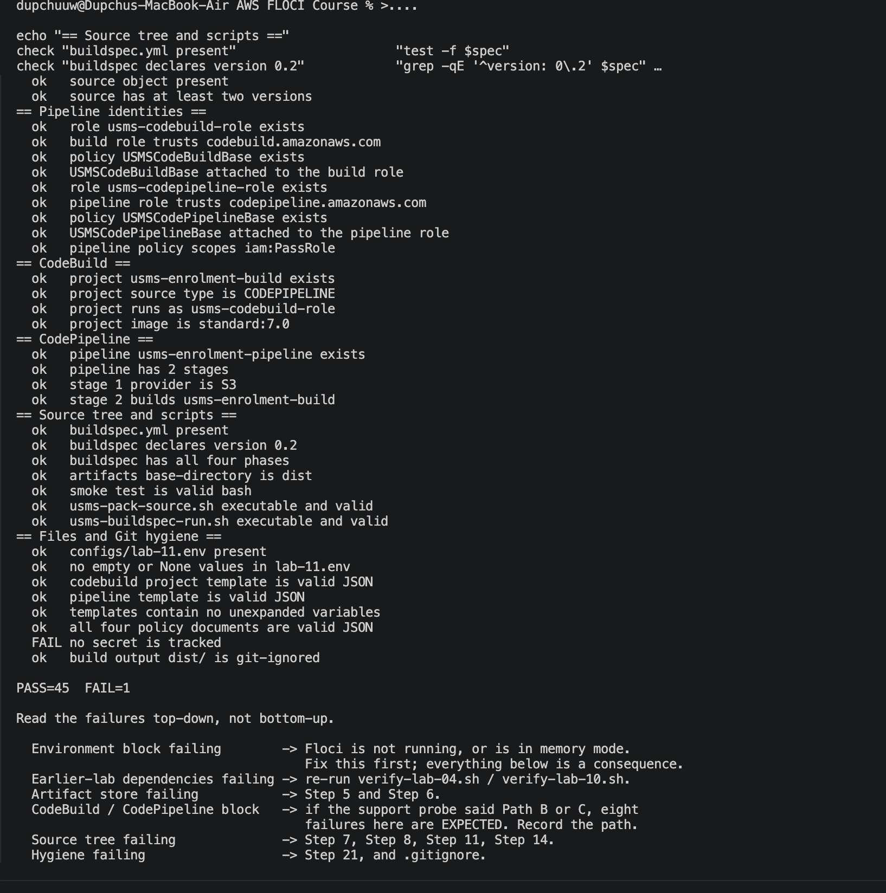

# Lab 11 — CI/CD Pipeline with CodeBuild and CodePipeline


## 1. Objective

Build a source-to-artifact pipeline for the enrolment service:
- a versioned, private S3 artifact store;
- a small app with a `buildspec.yml` that validates config, builds `dist/`, stamps a release, and smoke-tests the result;
- least-privilege identities for CodeBuild and CodePipeline;
- a CodeBuild project;
- a two-stage pipeline (S3 Source, then CodeBuild Build).

Then release new versions through the pipeline, break the build on purpose, diagnose the failure, and fix it.


## 2. Resources created

| Resource | Identifier |
|---|---|
| Artifact bucket | `usms-pipeline-artifacts` — versioning Enabled, all 4 public-access blocks on, tags Project=USMS, Tier=pipeline, Lab=11 |
| Source object | `source/usms-enrolment-src.zip`. Current version `4845481b-a65b-4a4e-9579-a9f0a87725c9`; 5 versions in total (r3, r4, r5, v2-broken, fixed) |
| App source | `labs/lab-11-cicd/app/` (`VERSION`, `src/`, `config/service.json`, `tests/smoke.sh`, `buildspec.yml`) |
| Build role | `usms-codebuild-role` + policy `USMSCodeBuildBase` |
| Pipeline role | `usms-codepipeline-role` + policy `USMSCodePipelineBase` (tags Project=USMS, Tier=pipeline, Lab=11) |
| Build project | `usms-enrolment-build`. Image `aws/codebuild/standard:7.0`, `BUILD_GENERAL1_SMALL`, timeout 15 min, source/artifacts `CODEPIPELINE` |
| Pipeline | `usms-enrolment-pipeline`. Source/`FetchSource` (S3), then Build/`BuildArtifact` (CodeBuild) |
| Scripts | `scripts/utilities/usms-pack-source.sh`, `scripts/utilities/usms-buildspec-run.sh` |
| Templates | `templates/lab-11-codebuild-project.json`, `templates/lab-11-pipeline.json` |
| Policies | `policies/trust-codebuild.json`, `trust-codepipeline.json`, `usms-codebuild-policy.json`, `usms-codepipeline-policy.json` |
| Configuration | `configs/lab-11.env` (26 exports, no empty values) |


## 3. Building the pieces

### 3.1 Artifact store (Steps 5–6)
`usms-pipeline-artifacts` was created with versioning Enabled and all four public-access blocks set to `true`. Versioning was proven by writing `probe/versioning.txt` twice: two VersionIds appeared. The probe versions were then deleted (count 0).

CodePipeline needs a versioned bucket for two reasons:
- an S3 source action tracks *which version* it took;
- every release can be traced back to an exact source object.

### 3.2 The application and buildspec (Steps 7–11)
`index.html` contains the placeholders `__RELEASE__` and `__BUILT_AT__`. `config/service.json` names the ECS target (`usms-ecs-cluster` / `usms-enrolment-svc` / container `enrolment-api`).

`buildspec.yml` (version 0.2) has four phases:
- **install:** a toolchain check (`python3 --version`).
- **pre_build:** validates configuration *before* anything is built:
  - `service.json` must be valid JSON;
  - `grep -q '"container": "enrolment-api"'`;
  - `grep -q '"port": 80'` (the Step 8 "your turn" check);
  - `VERSION` must be non-empty.
- **build:** copies `src/` to `dist/`, substitutes the placeholders, and writes `build-metadata.json` (`service`, `release`, `builtAt`, `buildId`, `sourceVersion`). `buildId` and `sourceVersion` come from `CODEBUILD_*` variables, or `local` if those are unset.
- **post_build:** `tests/smoke.sh`, with seven assertions. Four of them prove that no placeholder survived anywhere in `dist/`.

`artifacts` uses `base-directory: dist`, so the artifact root holds the files themselves rather than a `dist/` folder. `dist/` is git-ignored (`.gitignore:31`).

### 3.3 Build identity (Step 11)
- **Trust policy:** `codebuild.amazonaws.com` with `StringEquals aws:SourceAccount = 000000000000`. This is the confused-deputy guard: only builds in this account can assume the role.
- **`USMSCodeBuildBase`** grants only:
  - logs for `/aws/codebuild/usms-enrolment-build`;
  - bucket-level S3 reads (`GetBucketLocation`, `GetBucketVersioning`, `ListBucket`) on the bucket ARN;
  - object read/write (`GetObject`, `GetObjectVersion`, `PutObject`) on `usms-pipeline-artifacts/*`. This is Lab 01's bucket-ARN versus object-ARN split.

### 3.4 Build project (Step 11)
`usms-enrolment-build` was created from `templates/lab-11-codebuild-project.json`. It started with S3 source `usms-pipeline-artifacts/source/usms-enrolment-src.zip` and S3 artifacts, image `aws/codebuild/standard:7.0`, service role `usms-codebuild-role`, and log group `/aws/codebuild/usms-enrolment-build`.

The timeout was later aligned with the lab's 15 minutes, in both the project and the template.

### 3.5 Packing the source (Step 12)
`usms-pack-source.sh <app-dir> <output.zip>` zips *from inside* the app tree, excluding `dist/` and `.DS_Store`. It then checks that `buildspec.yml` sits at the archive root, because CodeBuild looks for it there. The archive had 9 entries.


## 4. Running builds on Floci (Steps 12–14)

This section records what Floci actually does. Several results that looked like success turned out to be empty runs, so each claim below rests on a probe built to tell the possibilities apart.

### 4.1 The build image could not be pulled
Build `:1` ended in **FAULT** (a service-level failure, not a buildspec failure). The phase context and the Floci log showed:

```
Pulling image: aws/codebuild/standard:7.0
Status 404: pull access denied for aws/codebuild/standard, repository does not exist
```

`aws/codebuild/standard:7.0` is the image AWS hosts internally for real CodeBuild; it is not published on Docker Hub. Floci's image service checks the local cache before pulling. So a local image was tagged with that exact name, which keeps the project configuration (and the "image is standard:7.0" check) unchanged:

1. **First attempt:** `python:3.12-slim` tagged as-is. Build `:2` "succeeded", but the Floci log showed the container lived about 56 ms. That image's default command (`python3`) exits immediately, so nothing ran.
2. **Working alias:** `FROM python:3.12-slim` + `CMD ["sleep","infinity"]`, tagged `aws/codebuild/standard:7.0`. Containers then stayed up long enough to run commands.

On real AWS the managed image is used and no alias is needed.

### 4.2 Probes that established what Floci executes

| Build | What was tested | Result | Conclusion |
|---|---|---|---|
| `:3` | inline buildspec `echo PROBE-RAN; exit 1` | FAILED, message `Exit code 1: PROBE-RAN` | Inline commands really execute. Their output appears only in a failed phase's context message |
| `:5` | inline `ls` / `cat VERSION` on S3 source | `PWD=/codebuild/output/src/src VERSION=r3`, files `buildspec.yml config src tests` | S3 source *is* downloaded and unpacked |
| `:6` | inline real tool commands | `CONFIG-OK`, `dist/` built | python3, cp and json.tool work in the build container |
| `:13` | inline `ls` on a CODEPIPELINE-sourced project | `FILES=[] BUILDSPEC=no` | Floci gives CodePipeline-sourced builds an empty work directory |
| `:14` | `--source-type-override S3` + inline `ls` | `FILES=[]` | Floci ignores source overrides |
| `:15` | project on S3 source, v2 (broken) source, buildspec **file** `buildspec.yml` | SUCCEEDED (should have failed) | Floci does not read `buildspec.yml` from the source |

**The key finding:** Floci treats the project's `buildspec` field as *inline YAML*, never as a path into the source. The string `buildspec.yml` parses to YAML with no phases, so nothing runs and the build reports SUCCEEDED.

So builds `:4`, `:8` and `:15` were empty runs. My earlier note that called `:4` a genuine run was **corrected** in `notes/lab-11-notes.md` once build `:15` exposed this.

### 4.3 Proving the real buildspec on Floci
With the project on S3 source (so Floci unpacks the zip), the **real** `buildspec.yml` was passed inline with `--buildspec-override file://labs/lab-11-cicd/app/buildspec.yml`:

| Build | Source | Result |
|---|---|---|
| `:16` | v2 (container `enrolment-api-v2`) | **FAILED at PRE_BUILD**. The last output was `pre_build - validate configuration`, then the `grep -q` container check exited 1 |
| `:17` | fixed (container `enrolment-api`) | **SUCCEEDED** |
| `:18` | fixed + `cat dist/build-metadata.json; exit 1` appended to post_build | Smoke **7/7**, then metadata `"release": "r5"`, `"buildId": "usms-enrolment-build:18"` |

Build `:18` is the in-CodeBuild proof of the artifact contents. `buildId` is a real build ID, not `local`, so the file was produced inside CodeBuild. `sourceVersion` is `local` because Floci does not set `CODEBUILD_RESOLVED_SOURCE_VERSION`, so the lab's conditional `sourceVersion` check does not apply.

The project was switched back to `CODEPIPELINE` afterwards (`CODEPIPELINE CODEPIPELINE`).

### 4.4 Logs and artifacts (Step 13)
- The log group and stream (`2026/11/22/usms-enrolment-build/N`) are created, but they hold **0 events**.
- **No artifact is uploaded**: the bucket held only `source/` objects after every successful build.

The lab warns that log streams are often empty on Floci. Here the artifact is missing as well, so the evidence for the build output comes from build `:18`'s phase message and from the local runner.

### 4.5 Local buildspec runner (Step 14)
`usms-buildspec-run.sh <app-dir> [buildspec]`:
- parses `buildspec.yml` with PyYAML if it is installed, otherwise with a built-in minimal parser (used on this Mac);
- exports `env.variables`;
- runs install → pre_build → build → post_build in the app directory, stopping at the first failing command.

It is compatible with macOS bash 3.2.

| Run | Result |
|---|---|
| Clean source (r3) | all phases SUCCEEDED, smoke 7/7, exit 0; metadata `release r3`, `buildId local`; 0 placeholders left |
| v2 source | `PHASE PRE_BUILD FAILED (command #3 exit 1)`, exit 1 |
| Fixed source | smoke 7/7, exit 0 |

How it differs from CodeBuild:
- no `CODEBUILD_*` variables (hence `local`);
- no upload;
- a failure stops the run immediately, whereas CodeBuild still runs post_build after a failed build phase.

A local pass and a CodeBuild pass are different claims. This report shows each separately.


## 5. The pipeline (Steps 15–20)

### 5.1 Pipeline identity (Step 15)
- **Trust policy:** `CodePipelineAssumesThisRole`, principal `codepipeline.amazonaws.com`, with `StringEquals aws:SourceAccount = 000000000000`.
- **`USMSCodePipelineBase`** has three statements:
  - `ReadAndWriteTheArtifactStore`: five S3 actions on the bucket and `/*`.
  - `StartAndWatchTheEnrolmentBuildOnly`: `StartBuild`, `BatchGetBuilds` and `StopBuild` on the one project ARN.
  - `PassTheBuildRoleAndOnlyToCodeBuild`: `iam:PassRole` on `usms-codebuild-role` only, conditioned on `iam:PassedToService = codebuild.amazonaws.com`.

The `PassedToService` condition stops anyone who can edit the pipeline from passing the role to a different service.

Floci does not enforce IAM, so this policy is evaluated on its structure; verify check 23 confirms the condition is present.

### 5.2 Pipeline definition and creation (Steps 16–17)
`templates/lab-11-pipeline.json` defines:
- **Source/FetchSource:** S3, bucket `usms-pipeline-artifacts`, key `source/usms-enrolment-src.zip`, `PollForSourceChanges "false"`, output `SourceOutput`.
- **Build/BuildArtifact:** CodeBuild, `ProjectName usms-enrolment-build`, input `SourceOutput`, output `BuildOutput`.

The role ARN was expanded at write time, leaving 0 `$` characters in the file. `create-pipeline` returned the name, the role and **2 stages**, and the read-back matched exactly.

Floci did **not** auto-start an execution on creation: `get-pipeline-state` showed `None` for both stages.

### 5.3 Handing the project to the pipeline (Step 18)
`update-project` set the source to `CODEPIPELINE` (buildspec `buildspec.yml`) and the artifacts to `CODEPIPELINE`.

On AWS, a plain `start-build` would then be rejected with `InvalidInputException`. Floci accepted it (build `:7`).

### 5.4 Releases r4 and r5 (Step 19)

| Release | Source VersionId | Execution | Source stage | Build stage |
|---|---|---|---|---|
| r4 | `818ca4b2-643a-4f8b-a257-7cbab313f407` | `2ddb98ba…` **Succeeded** | Succeeded, external ID = the r4 VersionId | Succeeded → `usms-enrolment-build:9` |
| r5 (your turn) | `fc0b138d-485c-49c3-b1cb-0a9a2916c392` | `bd6a6aac…` **Succeeded** | Succeeded | Succeeded → `:10` |

After r5 the source object had **3 versions**, as the lab expects. Executions advance on Floci, and the Source stage records exactly the uploaded VersionId, linking each release to a build ID.

The limitation is in the handoff between the stages: Floci does not pass `SourceOutput` to CodeBuild (probe `:13`). So the pipeline-triggered builds ran in an empty directory, and no `usms-enrolment-pipeline/BuildOutput/` object was written. `release r5` and a real `buildId` were therefore shown with build `:18` (Section 4.3) rather than downloaded from BuildOutput.

### 5.5 Deliberate failure, diagnosis and fix (Step 20)
`config/service.json` was changed to `"container": "enrolment-api-v2"`, repacked, uploaded (`de58c228…`) and executed.

- **Through the pipeline:** execution `adefe954…` reported **Succeeded** (Source Succeeded, Build `:11` Succeeded). This is **not** a correct result. Build `:11` received an empty work directory (Section 5.4), so the pre_build check never ran. `outputs/lab-11-pipeline-state.json` records this state. On real AWS, this execution would show Build **Failed** in `PRE_BUILD`.
- **Diagnosis on Floci CodeBuild:** build `:16` (Section 4.3) shows the real diagnosis: **FAILED, phase PRE_BUILD**, saved to `outputs/lab-11-step20-codebuild-failure.json`. The `grep -q '"container": "enrolment-api"'` guard did its job: it rejected a config that would have pointed the ECS deploy at a container name that doesn't exist, before anything was built.
- **Local:** the runner failed at `PRE_BUILD` command #3 with exit 1 (`outputs/lab-11-step20-local-failure.txt`).
- **Fix:**
  1. Restored `enrolment-api`.
  2. Local run 7/7, exit 0 (`outputs/lab-11-step20-local-fixed.txt`).
  3. Repacked and uploaded (`4845481b…`).
  4. Build `:17` SUCCEEDED.
  5. The pipeline was rerun and reports Succeeded.


## 6. Floci vs real AWS

| Behaviour | Real AWS | Floci (this build) | Effect on the lab |
|---|---|---|---|
| `aws/codebuild/standard:7.0` | Managed image available | Not pullable (404) | Local alias image used (Section 4.1) |
| `buildspec` field `buildspec.yml` | Path to a file in the source | Parsed as inline YAML → empty run, SUCCEEDED | Real buildspec run with `--buildspec-override file://…` |
| Source overrides on `start-build` | Honoured | Ignored | Project temporarily switched to S3 source for the proofs |
| CodeBuild log events | Streamed to CloudWatch | Group/stream created, 0 events | Output read from failed-phase context messages |
| Build artifact upload | Uploaded to S3 / BuildOutput | Not uploaded | Metadata shown via build `:18`; artifact inspected locally |
| `start-build` on a CODEPIPELINE project | `InvalidInputException` | Accepted | Recorded only |
| Auto execution on `create-pipeline` | Starts one execution | None started | Recorded only |
| SourceOutput → CodeBuild handoff | Source zip unpacked for the build | Empty work directory | Pipeline builds always "succeed"; Step 20 failure not visible in the pipeline |
| `CODEBUILD_RESOLVED_SOURCE_VERSION` | Set | Not set | `sourceVersion: local` |
| IAM evaluation | Enforced | Not enforced | Policies verified by structure |

None of these is a defect in the Lab 11 work. Every resource was created with AWS-valid calls and passes the verify. The execution gaps are emulator behaviour, and each one was isolated with a probe rather than assumed.


## 7. Verification

Official `verify-lab-11.sh`: **PASS=45 FAIL=1**

| Block | Result |
|---|---|
| Environment (4) | all ok |
| Earlier-lab dependencies (5) | all ok — including container name `enrolment-api` |
| Artifact store (5) | all ok — versioning Enabled, public access blocked, ≥2 source versions |
| Pipeline identities (9) | all ok — including `iam:PassRole` scoped with `iam:PassedToService` |
| CodeBuild (4) | all ok — source type CODEPIPELINE, role, image `standard:7.0` |
| CodePipeline (4) | all ok — 2 stages, S3 source, builds `usms-enrolment-build` |
| Source tree and scripts (7) | all ok |
| Files and Git hygiene (8) | 7 ok, **1 FAIL** |

**The one fail is "no secret is tracked", a false positive.** The check fails on any tracked path under `outputs/`. The only such file is `outputs/.gitkeep`, the intentional empty placeholder that keeps the directory in Git, while `.gitignore` blocks every real output. No credential, key or secret is tracked. This is the same result as in every previous lab.

The verify checks resource configuration, which is why it reads Path A even though Floci's pipeline-to-build handoff is empty. The execution evidence for the build is in Sections 4.3–4.5 and 5.5.



## 8. Outcome

Lab 11 is complete. The artifact store, identities, build project and two-stage pipeline exist and pass every functional check (45/46, the remaining fail being the `.gitkeep` false positive). The pipeline ran three releases (r4, r5 and the fixed source), each Source stage linked to the exact S3 VersionId.

The buildspec was proven on Floci's own CodeBuild with the real file:
- **Build `:16`:** the broken config is caught at PRE_BUILD.
- **Build `:17`:** the fixed config passes.
- **Build `:18`:** smoke 7/7 inside CodeBuild, release r5, a real build ID.

The local runner confirms the same three results.

The main lesson from Floci was that SUCCEEDED doesn't prove anything ran. Each green result here was checked with a probe that could have failed, and the one that couldn't (the empty pipeline build) is reported as such rather than counted as a pass.