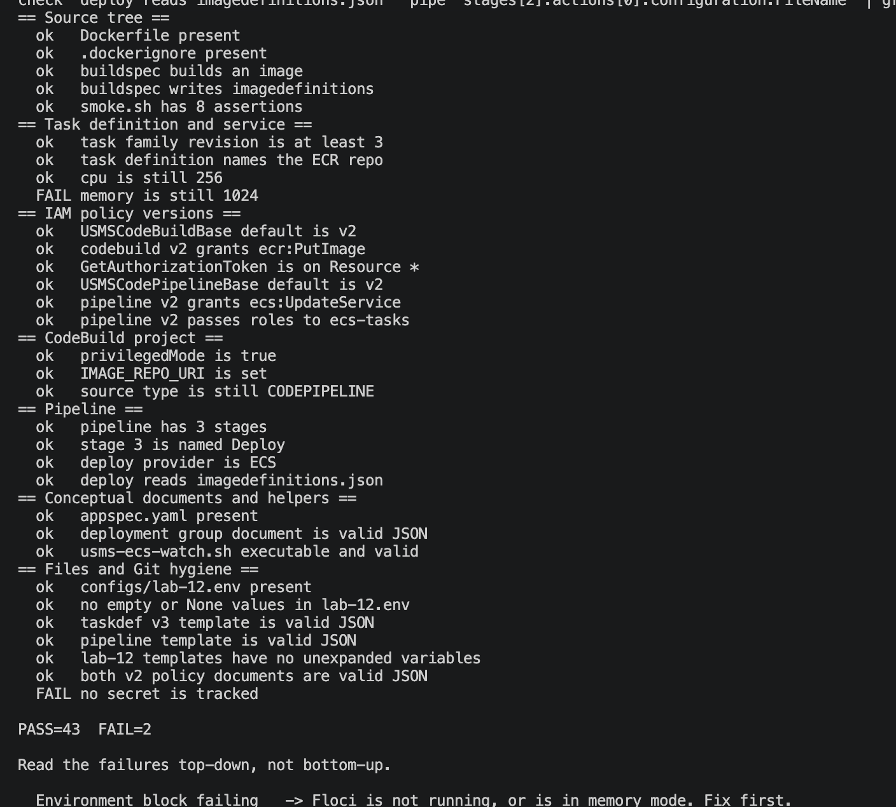

# Lab 12 — Deploying to Amazon ECS from the Pipeline


## 1. Objective

Extend the Lab 11 pipeline so a release reaches the running ECS service:
- create a private ECR repository, push an image and prove it by digest;
- derive a new task definition revision that changes only the image, and deploy it;
- version both pipeline policies to v2;
- give CodeBuild privileged Docker and extend the buildspec to build, push and write `imagedefinitions.json`;
- add an ECS Deploy stage, release a version, and run a rollback drill;
- specify, but not perform, a CodeDeploy blue/green deployment.


## 2. Resources created or changed

| Resource | Identifier |
|---|---|
| ECR repository | `usms-enrolment`. MUTABLE, `scanOnPush=true`, AES256, tags Project=USMS, Tier=registry, Lab=12 |
| Registry URI | `000000000000.dkr.ecr.us-east-1.localhost:4566/usms-enrolment` |
| Images | `r6` (pushed by hand, then by the buildspec) and `r7` (`sha256:01f34025f912af7ed3aa72d8506122228eb233e9ea8cecefc006e29332bf795c`) |
| Task definitions | `usms-enrolment:2` (r6), **`:3` (r7, live)**, `:4` (r8, broken by design, deregistered) |
| ECS service | `usms-enrolment-svc` on `:3`, 2/2 tasks running the r7 image; network repaired to the current private subnets |
| Policy versions | `USMSCodeBuildBase` **v2** (default), `USMSCodePipelineBase` **v2** (default); v1 kept for both |
| Build project | `usms-enrolment-build`, `privilegedMode: true`, with 4 environment variables incl. `IMAGE_REPO_URI` |
| Pipeline | `usms-enrolment-pipeline` v2: Source (S3), then Build (CodeBuild), then **Deploy (ECS)** |
| App additions | `Dockerfile`, `.dockerignore`, extended `buildspec.yml` (Lab 11 copy kept as `buildspec.yml.lab08a`), 8-assertion `smoke.sh` |
| Scripts | `deploy-support-probe.sh`, `usms-ecs-watch.sh`, updated `usms-buildspec-run.sh` |
| Blue/green documents | `templates/lab-12-appspec.yaml`, `templates/lab-12-codedeploy-deployment-group.json` |
| Configuration | `configs/lab-12.env` (26 exports, no empty values) |


## 3. Registry and image (Steps 1–9)

### 3.1 Probe (Step 3)
`deploy-support-probe.sh` checks:
- the Docker daemon;
- `ecr describe-repositories`;
- `create-repository` and `delete-repository --force` on a throwaway `usms-probe-delete-me`, which was confirmed gone afterwards;
- `ecs list-clusters` and `deploy list-applications`.

All five returned YES, giving `USMS_CICD_DEPLOY_PATH=A` and `USMS_CODEDEPLOY_SUPPORTED=true`.

### 3.2 Port range (Step 4): attempted, reverted, documented
Adding `"5100-5104:5100-5104"` to the `floci` service and recreating it failed with:

```
Bind for 127.0.0.1:5100 failed: port is already allocated
```

This Floci build runs ECR as a **separate sidecar container** (`floci-aws-floci-course-ecr-registry`, `127.0.0.1:5100->5000`), started on the first ECR call, and publishes the port itself (`FLOCI_SERVICES_ECR_REGISTRY_BASE_PORT=5100`). The mapping on the `floci` service made two containers claim the same port.

The line was removed and Floci came back with its hybrid data intact; the ECS service was still ACTIVE. The line is kept in `docker-compose.yml` as a commented, explained entry. Clients reach the registry through Floci's main endpoint (`…localhost:4566`), so publishing the range is not needed on this build.

### 3.3 Repository, login, build, push (Steps 5–8)
- **Step 5:** created the repository with the specified mutability, scanning and encryption settings. On Floci, scanning is stored but not performed.
- **Step 6:** `aws ecr get-login-password | docker login --password-stdin` printed **Login Succeeded**. The password went in through stdin only and never appeared on a command line.
- **Step 7:** `Dockerfile` is `nginx:1.27-alpine` plus `COPY dist/`. `.dockerignore` keeps sources, config, tests and the buildspec out of the image.
- **Step 8:** set `VERSION` to `r6`, ran the local build (smoke 7/7), then built, tagged and pushed `r6`.

### 3.4 Proof by digest (Step 9)
- `describe-images` showed `r6` with the same digest the push printed. Floci reports `imageSizeInBytes` as 0, a cosmetic quirk.
- The local copies were deleted with `docker rmi`, then `docker pull <uri>@<digest>` succeeded.
- `docker run` on the pulled image printed `"release": "r6"`.

So the registry holds this build, addressed by its content hash rather than by a tag that could later be moved. Digests are recorded in `outputs/lab-12-image-digest.txt`.


## 4. Task definition and service (Steps 10–11)

### 4.1 The revision baseline
The lab expects an existing `:2` with 1024 MB and a health check, so that Step 10 produces `:3`. This environment had only `usms-enrolment:1`:
- 256 CPU, **512 MB**, no health check, no log driver;
- rebuilt from `templates/lab-04-taskdef.json` after the Floci data loss (commit `5a5f76c`).

No earlier revision with 1024 MB exists in the repository or its history, so none was invented. As a result, revision numbers here are **one lower than the lab's**: `:2` corresponds to the lab's `:3`, and so on.

### 4.2 Deriving the revision (Step 10)
`describe-task-definition` was saved to `templates/lab-12-taskdef-base.json`. Then a script:
- removed the read-only fields;
- dropped the null-valued keys that Floci returns;
- found the container named `enrolment-api` (asserting exactly one);
- changed **only** its image, from `public.ecr.aws/nginx/nginx:stable-alpine` to `…/usms-enrolment:r6`.

The result `templates/lab-12-taskdef-v3.json` is valid JSON with zero `$`. Registering it produced `usms-enrolment:2`, with cpu 256, memory 512 and both roles preserved.

### 4.3 Deploying it, and why tasks didn't start (Step 11)
`usms-ecs-watch.sh <cluster> <service> [iterations]` polls `describe-services` every 10 s. It exits 0 once there is one deployment and the PRIMARY deployment's running count equals desired. It replaces `aws ecs wait services-stable`, which can exhaust silently on Floci.

After `update-service`, the service moved to `:2`, but running stayed at 0. The Floci log gave the cause:

```
Service reconciler failed to start task for usms-enrolment-svc: The subnet ID 'subnet-e726cf6c' does not exist
```

The service's `awsvpcConfiguration` still named subnets from before the data-loss rebuild. It was repointed with `update-service --network-configuration` to the current private subnets from `lab-02.env` (`subnet-6739a4fc`, `subnet-09571447`), keeping security group `sg-33f7f9db3cd53212f`.

The watcher then reported **STABLE, 2/2 running**, and `docker ps` showed two `enrolment-api` containers on image `68ce2660…`, the digest the buildspec pushed for r6. From this point the service runs real containers from this lab's ECR images.


## 5. Identities and build changes (Steps 12–15)

### 5.1 `USMSCodeBuildBase` v2 (Step 12)
Created with `create-policy-version --set-as-default`. Default is **v2**; v1 is retained, and a policy holds at most five versions. Five statements:

| Sid | Effect | What it grants or denies |
|---|---|---|
| `WriteItsOwnBuildLogs` | Allow | Logs only on `/aws/codebuild/usms-enrolment-build` |
| `ReadSourceAndWriteArtifacts` | Allow | S3 get/put and bucket metadata on `usms-pipeline-artifacts` only |
| `GetARegistryTokenWhichCannotBeScoped` | Allow | `ecr:GetAuthorizationToken` on `*`, because the action has no resource-level scoping |
| `PushAndPullTheEnrolmentImageOnly` | Allow | Layer and image push/pull on `repository/usms-enrolment` only |
| `BuildsDoNotTouchStudentRecords` | Deny | `s3:*` on `usms-student-data` |

The explicit Deny means a build can never reach student records, even if a later Allow is written too broadly.

### 5.2 Privileged Docker in CodeBuild (Step 13)
`templates/lab-12-codebuild-update.json` sets `privilegedMode: true` and four variables, including `IMAGE_REPO_URI` = the ECR URI.

The `environment` block is replace-only, so the image and compute type were restated; leaving them out would have cleared them. Read-back: source still **CODEPIPELINE**, role `usms-codebuild-role`, privileged **True**.

### 5.3 Extended buildspec (Step 14)
| Phase | What it does |
|---|---|
| pre_build | Validates `VERSION` and `service.json` (container name and port); sets `IMAGE_URI=$IMAGE_REPO_URI:$(cat VERSION)`; logs in to ECR when Docker is reachable |
| build | Assembles `dist/` and writes `build-metadata.json` (now including `imageUri`); runs `docker build` and `push` (guarded); writes `dist/imagedefinitions.json` as `[{"name":"enrolment-api","imageUri":…}]` |
| post_build | Runs the smoke test, now with an **8th assertion**: `imagedefinitions.json` is a one-element array naming `enrolment-api` |

`IMAGE_REPO_URI` defaults to `nginx` in the buildspec, and the project variable overrides it. CodeBuild's precedence is start-build override > project variable > buildspec default. The local runner was updated to honour this: a variable already set in the shell plays the role of the project variable. Tested both ways: with the variable set the image is the ECR URI; without it, `nginx`.

The local run with `IMAGE_REPO_URI` set did the real work through the buildspec's own Docker path: Login Succeeded, pushed `r6` (`sha256:68ce2660…`), smoke **8/8**. The source was packed (12 files) and uploaded.

### 5.4 `USMSCodePipelineBase` v2 (Step 15)
Default is **v2**, with six statements:
1. `ReadAndWriteTheArtifactStore`
2. `StartAndWatchTheEnrolmentBuildOnly`
3. `PassTheBuildRoleAndOnlyToCodeBuild`
4. `DeployToTheEnrolmentServiceOnly`: `ecs:DescribeServices` and `UpdateService` on the one service ARN.
5. `ReadAndRegisterTaskDefinitions`: on `*`, because these actions have no task-definition resource scoping.
6. `PassTheTwoEcsRolesAndOnlyToEcsTasks`: the exec and task roles, conditioned on `iam:PassedToService = ecs-tasks.amazonaws.com`.

Statement 6 means the pipeline can hand the ECS roles only to ECS tasks, never to another service.

The Step 12 "your turn" draft is `notes/lab-12-my-pipeline-policy.json`. The lab text asks for five statements, but its own Step 15 policy has six; the draft uses the six-statement version.


## 6. Deploy stage, release and rollback (Steps 16–19)

### 6.1 Deploy stage (Step 16)
The current pipeline was saved (`templates/lab-12-pipeline-current.json`). A script then appended a stage, after asserting the first two stages are `Source` and `Build` and refusing to add a second `Deploy`:
- stage `Deploy`, action `DeployToECS`, category Deploy, provider **ECS**;
- `ClusterName usms-ecs-cluster`, `ServiceName usms-enrolment-svc`, `FileName imagedefinitions.json`, `DeploymentTimeout "10"`;
- input `BuildOutput`, no outputs.

`update-pipeline` is replace-only, so the whole document was sent. Read-back showed the pipeline at version 2 with **3 stages** and the artifact chain `null`, then `SourceOutput`, then `BuildOutput`.

### 6.2 End-to-end release of r7 (Step 17)
- The buildspec (through the local runner) built and pushed **r7** (`sha256:01f34025…`), smoke 8/8.
- The source was uploaded (`d9aa16ab…`) and execution `a2bdecfd…` was started.

| Stage | Result |
|---|---|
| Source | Succeeded. External ID = the r7 source VersionId |
| Build | Succeeded (build `:20`). An empty run, as established in Lab 11: Floci does not pass SourceOutput to CodeBuild |
| Deploy | **Failed: "Provider ECS is not available in Floci CodePipeline"** |

The lab's Floci notes anticipate this ("the ECS deploy provider may be unavailable"). The pipeline definition is correct, and all four pipeline verify checks pass on it.

The deploy was then completed **by hand, doing exactly what the ECS provider does**:
1. read the buildspec's own `dist/imagedefinitions.json`;
2. register a new revision with that image;
3. call `update-service`.

| Before | After |
|---|---|
| `usms-enrolment:2`, image `…:r6` | **`usms-enrolment:3`**, image `…:r7` |

cpu 256, memory 512 and both roles were unchanged. The watcher reported **STABLE 2/2**. The containers run image `01f34025…`, the r7 digest, and the image reports `"release": "r7"`.

Evidence is in `outputs/lab-12-deploy-evidence.txt`: the execution ID, source version, task definitions before and after, image URI and digest, and the note that the deploy was manual.

### 6.3 Rollback drill (Step 18)
`r8` was never pushed (`describe-images` → `ImageNotFoundException`). Deploying an `imagedefinitions.json` for `:r8` registered **`usms-enrolment:4`** and moved the service to it.

| Observation | Value |
|---|---|
| Floci log | `Failed to start ECS task … failed to resolve reference "…/usms-enrolment:r8": not found` |
| Deployment | `:4` PRIMARY, `IN_PROGRESS`, running 0/2, reason "deployment … in progress" |
| Circuit breaker | Did not trigger. Stored but not enforced on Floci; on AWS, `:4` would be marked FAILED and rolled back automatically |
| Old tasks | The r7 containers kept serving throughout |

**Rollback:** `update-service --task-definition usms-enrolment:3` brought the service to **STABLE 2/2 within about 10 s**, on fresh r7 containers. `VERSION` was reset to `r7` and the good source re-uploaded (`bab36bfc…`).

**Decision:** `usms-enrolment:4` was **deregistered** (now INACTIVE). It names an image that doesn't exist, so it can only ever fail; leaving it ACTIVE would invite someone to redeploy it.

### 6.4 Blue/green on paper (Step 19)
- **`templates/lab-12-appspec.yaml`:** `version 0.0`, a `TargetService` of type `AWS::ECS::Service` with the `<TASK_DEFINITION>` placeholder, container `enrolment-api`, port 80, `PlatformVersion LATEST`, and five lifecycle hooks, each naming a `usms-deploy-hook-*` function. PyYAML is not installed on this Mac, so the YAML parse was skipped, which the lab allows.
- **`templates/lab-12-codedeploy-deployment-group.json`** (valid JSON):
  - `usms-enrolment-app` / `usms-enrolment-dg`, role `usms-codedeploy-role`;
  - `ECSLinear10PercentEvery1Minutes`, BLUE_GREEN with traffic control;
  - terminate blue after 5 minutes, `CONTINUE_DEPLOYMENT` on timeout;
  - auto-rollback on `DEPLOYMENT_FAILURE` and `DEPLOYMENT_STOP_ON_ALARM`;
  - target groups `usms-enrolment-tg` and `usms-enrolment-tg-green`, with listener ARN placeholders.

Nothing was executed. The service's `deploymentController` remains `ECS`. It is immutable, so moving to `CODE_DEPLOY` would mean recreating the service.


## 7. Floci vs real AWS

| Behaviour | Real AWS | Floci (this build) | Effect on the lab |
|---|---|---|---|
| ECR port publishing | n/a | Registry runs as a sidecar that binds `127.0.0.1:5100` itself | Step 4 mapping reverted; it conflicts with the sidecar |
| Registry endpoint | `<acct>.dkr.ecr.<region>.amazonaws.com` | `…dkr.ecr.us-east-1.localhost:4566` (proxied) | Push and pull work normally |
| `imageSizeInBytes` | Real size | 0 | Cosmetic; pull by digest proves the image |
| Image scanning | Runs on push | Stored, not performed | Setting verified only |
| CodePipeline ECS deploy provider | Available | "Provider ECS is not available" | Deploy done by hand from the buildspec's `imagedefinitions.json` |
| SourceOutput → CodeBuild | Source unpacked | Empty work directory (Lab 11) | Images built and pushed by the buildspec via the local runner |
| Deployment circuit breaker | Fails and rolls back `:4` | Not enforced; `:4` stays IN_PROGRESS 0/2 | Rollback performed by hand |
| IAM evaluation | Enforced | Not enforced | Policies verified by structure |

Two issues were **environment repairs, not emulator gaps**: the missing `:2` revision and memory baseline, and the stale service subnets. Both trace back to the earlier Floci data-loss rebuild, and both are documented in Sections 4.1 and 4.3.


## 8. Verification

Official `verify-lab-12.sh`: **PASS=43 FAIL=2**

| Block | Result |
|---|---|
| Environment (4) | all ok |
| Lab 11 dependencies (4) | all ok |
| ECR (5) | all ok — repository, scanOnPush, registry host, image present, **tag r7 present** |
| Source tree (5) | all ok — Dockerfile, .dockerignore, buildspec builds an image and writes imagedefinitions, **smoke.sh has 8 assertions** |
| Task definition and service (4) | 3 ok, **1 FAIL** |
| IAM policy versions (6) | all ok — both defaults v2, `ecr:PutImage`, `GetAuthorizationToken` on `*`, `ecs:UpdateService`, roles passed only to `ecs-tasks` |
| CodeBuild project (3) | all ok — privileged, `IMAGE_REPO_URI` set, source still CODEPIPELINE |
| Pipeline (4) | all ok — 3 stages, Deploy, provider ECS, reads `imagedefinitions.json` |
| Conceptual documents and helpers (3) | all ok |
| Files and Git hygiene (7) | 6 ok, **1 FAIL** |

**1. "memory is still 1024": baseline difference.** The check assumes the lab's earlier revision with 1024 MB. This environment's only baseline revision has **512 MB**: it was rebuilt from `templates/lab-04-taskdef.json` after the Floci data loss, and no 1024 MB revision exists in the repository or its history.

Step 10's rule is to change only the image, so memory stayed at its real baseline. Raising it just to satisfy the check would contradict the step. The neighbouring checks show the derivation itself was correct: revision ≥ 3, the ECR image named, and cpu unchanged at 256.

**2. "no secret is tracked": false positive.** The only tracked path under `outputs/` is `outputs/.gitkeep`, the intentional empty placeholder. `.gitignore` blocks every real output; no credential, key or secret is tracked. This is the same result as in every previous lab.



## 9. Outcome

Lab 12 is complete. On Path A, this lab's image travels from source through the buildspec into ECR (proven by digest) and onto the running service:
- the two `enrolment-api` tasks run the **r7 image**, digest `01f34025…`;
- the service is on `usms-enrolment:3`;
- both policies are at least-privilege v2 versions;
- the pipeline has its correctly defined third stage.

Two things Floci could not perform were completed by hand, and the report says so:
- **The ECS deploy action:** performed by hand from the buildspec's own `imagedefinitions.json`.
- **The circuit-breaker rollback:** the rollback drill was run by hand. It showed a bad image failing to pull, the old tasks serving throughout, and a return to stable within about 10 seconds.

Two problems inherited from the earlier data loss were found from Floci's own logs and fixed (the stale subnets) or documented (the 512 MB baseline), rather than worked around silently.