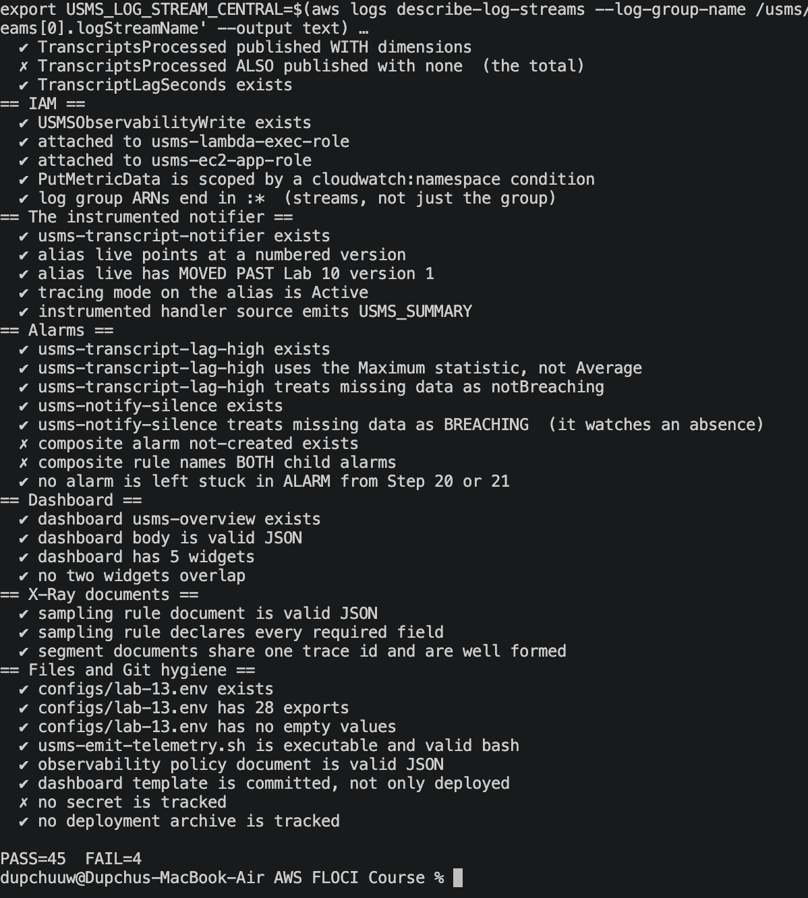

# Lab 13 — Centralised Logging and Monitoring with CloudWatch and X-Ray


**Support probe:**
- **Supported:** CloudWatch Logs, metric filters, CloudWatch metrics, alarms, dashboards and Lambda.
- **Unsupported:** Logs Insights and X-Ray.

**Result:** `verify-lab-13.sh` (official, 49 checks) reports **PASS=45 FAIL=4**, explained in Section 8:
- 2 composite-alarm checks: `PutCompositeAlarm` is unsupported in both Floci CloudWatch protocols.
- 1 check whose query cannot match on any platform; the metric it looks for does exist.
- 1 `outputs/.gitkeep` false positive.


## 1. Objective

Make the transcript path observable end to end:
- set retention on every USMS log group and create a central application log group;
- write structured events, and turn log lines into metrics with metric filters;
- publish custom metrics with dimensions and grant least-privilege telemetry permissions;
- instrument the Lambda notifier and enable active tracing;
- describe a trace with X-Ray segment documents and a sampling rule;
- alarm on lag and on silence, combine them, and build a dashboard;
- query the logs, and prove everything survives a restart.


## 2. Resources created or changed

| Resource | Identifier |
|---|---|
| Central log group | `/usms/central/application`, 30 days, stream `lab-13-20261122` |
| Retention | `/usms/ecs/enrolment` 30 d (was 7); the notifier and both edge-function groups 14 d. Also `/ecs/usms-enrolment` 30 d, `/aws/codebuild/usms-enrolment-build` 14 d, `/aws/ecr/registry` 14 d. **No course log group is left on never-expire** |
| Metric filters | `usms-notify-count` (notifier group, `USMS_NOTIFY` → `NotifyCount`), `usms-central-errors` (central group, `ERROR` → `CentralErrorCount`); both value 1, default 0, namespace `USMS/Application` |
| Custom metrics | `TranscriptsProcessed` {Faculty, Stage} plus a total with no dimensions, `TranscriptLagSeconds` {Stage=notify}, `EdgeDenyCount` {Stage=viewer-request} |
| Policy | `USMSObservabilityWrite`, attached to `usms-lambda-exec-role` and `usms-ec2-app-role` |
| Notifier | `usms-transcript-notifier`: version **3** = instrumented (lab's "v2"), version **4** = active tracing (lab's "v3"); alias `live` → 4 |
| Alarms | `usms-transcript-lag-high`, `usms-notify-silence` (both OK) |
| Composite alarm | `usms-transcript-pipeline-down`, **designed but not created** (unsupported); kept in `templates/lab-13-composite-alarm.json` |
| Dashboard | `usms-overview`, 5 widgets, no overlaps |
| X-Ray documents | `templates/lab-13-segment-{parent,subsegments,downstream}.json`, `templates/lab-13-sampling-rule.json` |
| Scripts | `scripts/utilities/usms-emit-telemetry.sh`; `labs/lab-13-cloudwatch-xray/make-segments.py` and `validate-segments.py` |
| Configuration | `configs/lab-13.env` (28 exports, no empty values) |

Notifier version numbers are one higher than the lab's because Lab 10 had already published versions 1 and 2.


## 3. Logs (Steps 1–10)

### 3.1 Baseline, probe and inventory (Steps 1–5)
All 12 earlier env files were sourced, and the identity is the Floci account.

| Inventory finding | Detail |
|---|---|
| Log group retention | Every log group was on `None` (never expires), except `/usms/ecs/enrolment` (7) |
| Alarms | `usms-enrolment-queue-high` (OK), plus two target-tracking alarms from Lab 06 |
| Namespaces | Only `USMS/Enrolment` |
| Dashboards | None |

### 3.2 Central group and retention (Step 6)
A `set_retention` helper checks each group exists before setting it. Retention matters for two reasons:
- **Cost:** log storage grows without limit otherwise.
- **Data minimisation:** log lines carry student IDs, so they shouldn't be kept forever.

### 3.3 Structured events (Step 7)
Five events were written with epoch-**millisecond** timestamps in ascending order. `rejectedLogEventsInfo` was `null`, and the read-back returned all 5 in order: the lab's four plus a non-matching `INFO heartbeat` event (the student task).

### 3.4 Filter patterns (Step 8)
- `USMS_NOTIFY` matched exactly event 2 of the four notifier-style samples.
- **Student task:** a plain `ERROR` pattern also matched `INFO retry ok after earlier ERRORS cleared`, a **false positive**, because a plain term matches as a substring on Floci.
- The quoted phrase **`"ERROR USMS_EVENT"`** matched only the failed transcript event and rejected both the successes and the false positive.

### 3.5 Metric filters and the end-to-end proof (Steps 9–10)
Both filters are attached to the correct groups with `defaultValue 0`. The proof happened on its own:
1. Uploading the probe object to `usms-student-data/transcripts/…` fired the **Lab 10 S3 notification**.
2. The notifier ran and wrote a `USMS_NOTIFY` line.
3. The filter produced a **real `NotifyCount` datapoint (Sum 1.0)**.

Floci evaluates metric filters, so the lab's synthetic `put-metric-data` fallback was **not** needed. The readback is in `outputs/lab-13-metric-readback.json`.


## 4. Metrics and permissions (Steps 11–12)

### 4.1 Custom metrics (Step 11)
`templates/lab-13-metric-data.json` publishes:
- `TranscriptsProcessed` for science and engineering, with dimensions {Faculty, Stage=notify};
- a **separate** total with no dimensions;
- two `TranscriptLagSeconds` observations.

`list-metrics` shows `TranscriptsProcessed` three times: two dimension sets plus `[]`. That demonstrates the rule that a metric's identity is its namespace, name and full dimension set, with no automatic roll-up. The lag statistics read **SampleCount 2.0, Maximum 1.91**, exactly as expected.

### 4.2 `USMSObservabilityWrite` (Step 12)
- **`WriteApplicationLogs`:** logs actions on `/usms/*:*` and `/aws/lambda/usms-*:*`. The `:*` suffix is needed because `PutLogEvents` acts on log streams, not just the group.
- **`PublishCustomMetricsInOurNamespaceOnly`:** `cloudwatch:PutMetricData` conditioned on `cloudwatch:namespace = USMS/Application`.
- **`SendTraces`:** the four X-Ray write and sampling actions.

The policy was created idempotently and attached to both roles.

**Fix made:** `configs/lab-01.env` stored `USMS_ROLE_EC2` as a full ARN, the same Lab 01 quirk corrected for the Lambda role in Lab 10. The verify uses it as a role *name*. It was corrected at the source to `usms-ec2-app-role` (backup `configs/lab-01.env.bak-lab13`). No other script uses the variable, and `lab-01.env` still has 16 exports.


## 5. The instrumented notifier (Steps 13–14)

### 5.1 Version 2 code (Step 13)
`labs/lab-13-cloudwatch-xray/transcript-notifier-v2/notifier.py`:
- **`trace_id`:** taken from `Root=` in `_X_AMZN_TRACE_ID`, falling back to the request ID.
- **`describe`:** pulls the event name, bucket, URL-decoded key, size and event time from each record.
- **Filtering:** keys outside `transcripts/` are skipped.
- **`head_object`:** sets a `readable` flag.
- **`faculty_of`:** takes the faculty from `transcripts/<faculty>/…`, guarded by `isalpha()` and a length of 20 or less to keep metric cardinality bounded.
- **`notify`:** prints a `USMS_NOTIFY` JSON line.
- **`publish`:** sends `TranscriptsProcessed` and `TranscriptLagSeconds` with short timeouts and one attempt. Failures log `USMS_METRIC_ERROR` and are swallowed, so telemetry can never fail the business path.
- **`USMS_SUMMARY`:** one final line per invocation.

The code was tested beforehand with mocked AWS calls, covering a URL-encoded key, a hostile path, a skipped key and a metric failure.

### 5.2 Deployment
1. Zipped with `python3 -m zipfile`.
2. `update-function-code`; the handler stayed `notifier.handler`.
3. The four environment variables were **merged** into the existing ones.
4. Published as **version 3**, then `live` → 3.

The invoke through `live` returned `200`, executed version 3, and gave the payload `"version":"v2"` with `trace_id`, `seconds`, `readable: true`, faculty `science` and **`metrics_published: true`**. So the function reaches CloudWatch from inside its container. The logs show `USMS_NOTIFY` and `USMS_SUMMARY`, including from an **S3-triggered** run.

**Exercise:** `live` was rolled back to version 1. The payload had no `trace_id`. It was then rolled forward to 3.

### 5.3 Active tracing (Step 14)
`--tracing-config Mode=Active` was set, version **4** published, and `live` → 4. The alias reports `Active`, and the invoke returned `200` on version 4.

Floci does not inject an `_X_AMZN_TRACE_ID` header, so `trace_id` falls back to the request ID. On AWS, Active mode adds the header, and the same code reports a `1-…` trace ID.


## 6. Traces (Steps 15–18), X-Ray unsupported

`PutTraceSegments` and `CreateSamplingRule` return `UnknownOperationException` (`Unknown operation: POST /TraceSegments`). The lab's structural fallback was used.

| Step | What was produced |
|---|---|
| 15–16 | `make-segments.py` writes three documents sharing one trace ID `1-<8 hex epoch>-<24 hex>`: **parent** `usms-transcript-notifier` (origin `AWS::Lambda::Function`, annotations faculty, stage, transcript_bytes and readable, metadata `usms`); the **same segment with subsegments** `s3-head-object` (aws), `render-pdf` (remote) and `cloudwatch-put-metric-data` (aws); and **downstream** `usms-student-data` (type subsegment, `parent_id` = parent id, origin `AWS::S3::Bucket`, HTTP 200). `validate-segments.py` runs **10 structural checks: 10/10 pass** |
| 17 | Annotation search `annotation.faculty = "science"` found 1 trace. The service graph was derived from the documents: notifier → s3-head-object, render-pdf, cloudwatch-put-metric-data and usms-student-data |
| 17 | `usms-emit-telemetry.sh [faculty] [seconds]` writes 1 `USMS_EVENT` log event, 2 metric points and 1 segment (sent to X-Ray if available, otherwise recorded in `outputs/lab-13-emitted-segments.jsonl`). It rejects bad input (`Sci3` gives exit 2). Two real runs were made with lag kept below the alarm threshold |
| 18 | `templates/lab-13-sampling-rule.json`: `usms-transcripts-sampling`, Priority 1000, FixedRate 0.10, ReservoirSize 2, ServiceName `usms-transcript-notifier`, other fields `*`, Version 1 |

**Correction made:** I first wrapped the sampling rule in `{"SamplingRule": …}`, the `--cli-input-json` form. The verify, like `create-sampling-rule --sampling-rule file://…`, expects the bare rule, so the file was rewritten.


## 7. Alarms, dashboard, queries, persistence (Steps 19–25)

### 7.1 Alarms (Step 19)

| Alarm | Metric | Stat / Period | Evaluation | Threshold | Missing data |
|---|---|---|---|---|---|
| `usms-transcript-lag-high` | TranscriptLagSeconds {Stage=notify} | Maximum / 60 s | 2 of 3 | > 2 s | notBreaching |
| `usms-notify-silence` | NotifyCount | Sum / 300 s | 3 of 3 | < 1 | **breaching** |

- **Lag uses Maximum:** one slow transcript is the signal, and an average would hide it.
- **Silence treats missing data as breaching:** the alarm watches an *absence*, and no data is exactly the failure it exists to detect.

Floci **does evaluate** alarms. `usms-notify-silence` moved from INSUFFICIENT_DATA to OK by itself on real notifier traffic.

### 7.2 Forced transition (Step 20)
`set-alarm-state` moved `usms-transcript-lag-high` to **ALARM** (StateReason "Lab 13 Step 20: forced to prove the alarm path"), then back to **OK**.

`DescribeAlarmHistory` is unsupported in both of Floci's protocols, so the transition is evidenced by `describe-alarms` StateValue and StateReason read-backs.

### 7.3 Composite alarm (Step 21), not supported
`usms-transcript-pipeline-down` with rule `ALARM("usms-transcript-lag-high") OR ALARM("usms-notify-silence")` was attempted twice:

| Path | Response |
|---|---|
| AWS CLI (JSON protocol) | `UnsupportedOperation: PutCompositeAlarm is not supported by CloudWatch JSON` |
| Query protocol (form-encoded POST, the classic SDK wire format) | `UnsupportedOperation: … not supported by CloudWatch Query` |

The design is kept in `templates/lab-13-composite-alarm.json`, ready for `put-composite-alarm --cli-input-json` on AWS.

The action draft (`outputs/lab-13-alarm-actions-draft.json`) attaches SNS only to the composite, so one incident gives one page, not one per child alarm. No actions were attached, as the lab specifies.

### 7.4 Dashboard (Step 22)
`usms-overview` uses a 24-column grid:

| Widget | Position | Content |
|---|---|---|
| Text runbook | Full width | Steps for each alarm |
| Transcripts by faculty | Left | timeSeries |
| Notify lag | Right | Max and average, with a threshold line at 2 |
| Single value | Left | NotifyCount and CentralErrorCount |
| Alarm status | Right | Alarm widget |

5 widgets, no overlaps (checked with a box-intersection test), no validation messages, and 5 widgets stored.

### 7.5 Logs Insights fallback (Step 23)
Insights is unsupported, so `filter-log-events --filter-pattern USMS_EVENT` was aggregated locally. The equivalent query is `filter @message like /USMS_EVENT/ | parse … as faculty | stats count() by faculty`.

| Measure | Result |
|---|---|
| Rows matched | 6 |
| By faculty | science 4, engineering 2 |
| By event | processed 4, requested 1, failed 1 |
| Seconds | max 1.91, average 0.958 |

### 7.6 Restart persistence (Step 24)
`floci-down.sh` (stop, not `down -v`) then `floci-up.sh`. The pre- and post-restart inventories cover log groups and retention, filters, alarms, dashboards, metrics, alias, tracing mode and policy attachments. They were **IDENTICAL**.

Metric **data** also survived: TranscriptLagSeconds showed the same 7 samples before and after. Hybrid storage persists both configuration and time series.

The samples include a maximum of 323.3 s. That was the Step 14 invoke replaying a test event about 5 minutes after its `eventTime`. The notifier measured the event's age correctly. It was more than 3 periods before the final checks, so `lag-high` is OK.

### 7.7 Environment file (Step 25)
`configs/lab-13.env` has **28 exports, no empty values**. Capabilities the emulator lacks are recorded honestly:
- `USMS_XRAY_SUPPORTED=false`
- `USMS_INSIGHTS_SUPPORTED=false`
- `USMS_ALARM_COMPOSITE=not-created`, following the lab's convention for things that couldn't be created.

Before the verify, one real transcript was uploaded through S3 → notifier, so `usms-notify-silence` was legitimately OK rather than forced.


## 8. Verification

Official `verify-lab-13.sh`: **PASS=45 FAIL=4**

| Block | Result |
|---|---|
| Environment (3) | all ok |
| Log layer (6) | all ok — central 30 d, notifier and ECS retention, **no group on never-expire**, stream present |
| Metric filters (3) | all ok |
| Metrics (4) | 3 ok, **1 FAIL** (Section 8.2) |
| IAM (5) | all ok — both attachments, namespace condition, `:*` ARNs |
| Instrumented notifier (5) | all ok — alias moved past v1, tracing Active, `USMS_SUMMARY` in source |
| Alarms (8) | 6 ok, **2 FAIL** (Section 8.1) |
| Dashboard (4) | all ok |
| X-Ray documents (3) | all ok |
| Files and Git hygiene (8) | 7 ok, **1 FAIL** (Section 8.3) |

### 8.1 Composite alarm checks (2): emulator limitation
`PutCompositeAlarm` is unsupported by this Floci build in **both** its CloudWatch protocols (Section 7.3). The rule and its design are submitted in `templates/lab-13-composite-alarm.json`. The env file records `USMS_ALARM_COMPOSITE=not-created`, which is why the check line names "not-created". On AWS both checks would pass.

### 8.2 "TranscriptsProcessed ALSO published with none": the verify query cannot match
The metric exists. `list-metrics` returns it with `"Dimensions": []`, and ``length(Metrics[?length(Dimensions)==`0`])`` returns **1**.

The check's helper uses:

```
Metrics[].join(`,`, Dimensions[].Name) || `NONE`
```

In JMESPath, `|| NONE` applies to the **whole projected list**, not to each metric. Run with the same JMESPath library the AWS CLI uses, on AWS-shaped data, it yields:

```
['Faculty,Stage', '', 'Faculty,Stage']
```

A no-dimension metric therefore prints an **empty string**, never `NONE`. Real AWS also returns `"Dimensions": []`, so this check fails on any platform. The official script was not modified.

### 8.3 "no secret is tracked": false positive
The only tracked path under `outputs/` is `outputs/.gitkeep`, the intentional empty placeholder. `.gitignore` blocks every real output and no secret is tracked. This is the same result as in every lab. The adjacent "no deployment archive is tracked" check passes: `outputs/lab-13-notifier-v2.zip` is ignored.



## 9. Floci vs real AWS

| Feature | Floci (this build) | Effect |
|---|---|---|
| Metric filters | **Evaluated** on ingestion | Real `NotifyCount` datapoints; synthetic fallback unused |
| Alarm evaluation | **Evaluated** | `notify-silence` went OK from real traffic |
| Custom metrics and dimensions | Supported | As on AWS |
| Dashboards | Stored; no rendering | Document validated |
| `PutCompositeAlarm` | Unsupported (JSON and Query) | 2 verify fails; design kept as a template |
| `DescribeAlarmHistory` | Unsupported (JSON and Query) | Transition shown by state read-backs |
| Logs Insights | Unsupported | `filter-log-events` plus local aggregation |
| X-Ray (segments, sampling, service graph) | Unsupported | Documents built and structurally validated (10/10); emitter records segments locally |
| Active tracing | Setting stored; no trace header injected | `trace_id` falls back to the request ID |
| IAM | Not enforced | Policy verified by structure |
| Persistence | Config **and** metric data survive a restart | `IDENTICAL` diff |

## 10. Outcome

Lab 13 is complete. Every USMS log group now expires. One upload produced real telemetry along the whole path:
1. an S3 event;
2. the instrumented notifier, which logs `USMS_NOTIFY` and `USMS_SUMMARY`;
3. a metric filter, which turns that line into `NotifyCount`;
4. the notifier's own custom metrics;
5. two alarms that Floci genuinely evaluates;
6. a 5-widget dashboard.

All of it survived a restart unchanged.

Floci's missing features (composite alarms, alarm history, Insights and X-Ray) were each probed, met with the lab's documented fallback where one exists, and recorded rather than worked around. The 4 remaining verify fails are explained individually above: 2 emulator limits, 1 check whose query cannot match on any platform, and 1 `.gitkeep` false positive.